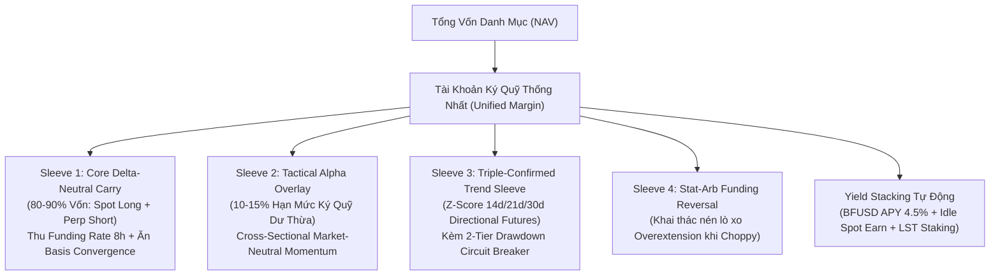
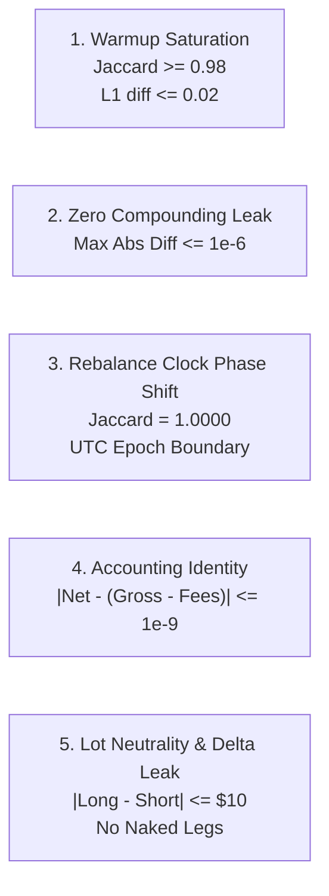
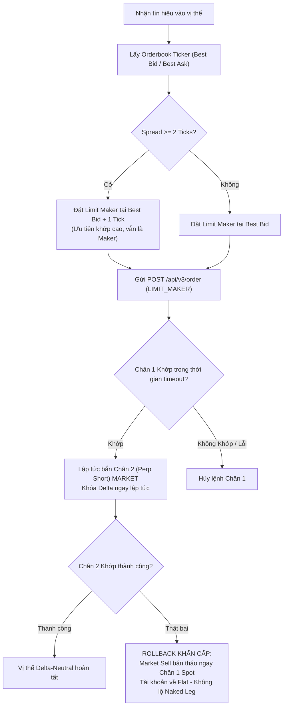
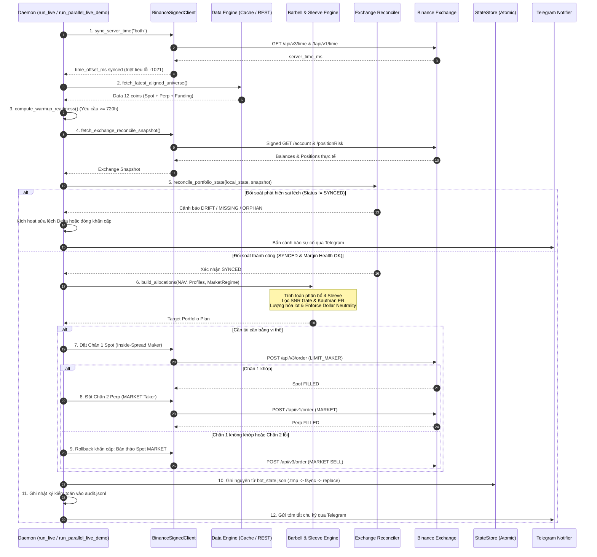

# BẢN KIẾN TRÚC TOÀN DIỆN HỆ THỐNG GIAO DỊCH ĐỊNH LƯỢNG (QUANT TRADING SYSTEM BLUEPRINT)
## TÀI LIỆU NẠP NGỮ CẢNH CHUYÊN SÂU DÀNH CHO GEMINI WEB (SYSTEM CONTEXT PROMPT & CODEBASE ARCHITECTURE)

> **Mục đích tài liệu:** Nạp toàn bộ ngữ cảnh kiến trúc, tư duy định lượng, chi tiết module, định luật bất biến toán học, dòng chảy dữ liệu, cơ chế thực thi lệnh và hướng dẫn mở rộng cho Gemini Web / Large Language Models.  
> **Repository:** `d:\Quant_trading`  
> **Ngôn ngữ & Thư viện:** Python 3.14+, NumPy, Pandas, CCXT, Pytest, Hypothesis.  
> **Thị trường mục tiêu:** Binance Spot & USDⓈ-M Futures (Hỗ trợ mở rộng Bybit, OKX).  
> **Trạng thái kiểm thử:** 842/842 Unit & Integration Tests đạt trạng thái PASS 100%.  
> **Kiến trúc cốt lõi:** Multi-Sleeve Barbell Unified Margin Portfolio (Tier 1 Core Cash & Carry + Tier 2 XS Momentum Alpha Overlay + Tier 3 Directional Trend Sleeve + Tier 4 Stat-Arb Reversal Sleeve + Macro Regime Switcher + Yield Stacking).

---

## MỤC LỤC CHI TIẾT
1. [Tổng Quan Hệ Thống & Triết Lý Định Lượng (Quantitative Philosophy)](#1-tổng-quan-hệ-thống--triết-lý-định-lượng)
2. [Lịch Sử Tiến Hóa Qua 28 Sprint (Evolutionary Roadmap)](#2-lịch-sử-tiến-hóa-qua-28-sprint)
3. [Cấu Trúc Thư Mục Toàn Diện & Vai Trò Thành Phần](#3-cấu-trúc-thư-mục-toàn-diện--vai-trò-thành-phần)
4. [5 Định Luật Bất Biến Định Lượng (The 5 Golden Quant Invariants)](#4-5-định-luật-bất-biến-định-lượng)
5. [Giải Phẫu Chi Tiết 23 Module Cốt Lõi Trong `src/`](#5-giải-phẫu-chi-tiết-23-module-cốt-lõi-trong-src)
6. [Hệ Thống 4 Sleeve Alpha & Bộ Máy Profile Tournament (Sprint 25–28)](#6-hệ-thống-4-sleeve-alpha--bộ-máy-profile-tournament)
7. [Tầng Thực Thi Mạng, Quản Trị Rủi Ro & Cơ Chế Khớp Lệnh Sàn](#7-tầng-thực-thi-mạng-quản-trị-rủi-ro--cơ-chế-khớp-lệnh-sàn)
8. [Quy Trình Dòng Chảy Dữ Liệu & Vòng Lặp Vận Hành (End-to-End Pipeline)](#8-quy-trình-dòng-chảy-dữ-liệu--vòng-lặp-vận-hành)
9. [Các Lỗi Tinh Vi Đã Được Khắc Phục (Battle-Tested Quant Fixes)](#9-các-lỗi-tinh-vi-đã-được-khắc-phục)
10. [Hướng Dẫn Dành Cho Gemini Web Khi Hỗ Trợ Phát Triển & Viết Code](#10-hướng-dẫn-dành-cho-gemini-web-khi-hỗ-trợ-phát-triển)

---

## 1. TỔNG QUAN HỆ THỐNG & TRIẾT LÝ ĐỊNH LƯỢNG

Hệ thống là một nền tảng giao dịch định lượng cấp tổ chức (**institutional-grade quantitative trading engine**) trên thị trường tiền mã hóa. Không giống như các bot giao dịch kỹ thuật thông thường (dựa trên indicator trễ, dễ bị quét thanh khoản và ăn mòn bởi phí sàn), hệ thống được xây dựng trên các nền tảng toán học và tài chính vi cấu trúc:

1. **Hiệu quả thị trường & Bóc tách Alpha/Beta (Newey-West HAC)**: Mọi chiến lược đều được kiểm định OLS Newey-West với độ trễ để bóc tách lợi nhuận thực ($\alpha$) ra khỏi chuyển động chung của thị trường ($\beta$).
2. **Cấu trúc vốn Barbell trên Unified Margin**:
   - **Nhánh An Toàn (Core Yield - 80% đến 90% NAV)**: Khai thác Delta-Neutral Funding Rate và Basis Convergence giữa Spot và Hợp đồng tương lai vĩnh cửu (Perpetual Futures), mang lại dòng tiền dương đều đặn với độ biến động cực thấp ($\text{Sharpe} > 3.5$, $\text{Max Drawdown} < 1.5\%$).
   - **Nhánh Tấn Công (Tactical Alpha Overlay - 10% đến 20% NAV)**: Chạy trên hạn mức ký quỹ dư thừa (**Unified Margin / Cross Margin**) mà không cần nạp thêm vốn tiền mặt, khai thác các bất đối xứng: Cross-Sectional Momentum, Trend Following đa khung thời gian, và Statistical Arbitrage đảo chiều theo Funding.
3. **Tuyệt đối không Look-Ahead & Không Compounding Leak**: Dữ liệu tính toán tại nến $t$ chỉ dùng thông tin $\le t-1$ hoặc giá mở cửa `open[t]`. Việc tái cân bằng neo theo mốc thời gian tuyệt đối (**UTC Epoch**) thay vì index cục bộ.



---

## 2. LỊCH SỬ TIẾN HÓA QUA 28 SPRINT

| Giai Đoạn | Sprint | Nội Dung Trọng Tâm & Bước Ngoặt Kỹ Thuật |
|---|---|---|
| **1. Directional Alpha** | Sprint 1–5 | Thử nghiệm Donchian Breakout, ATR Trailing Stop, ADX Regime, ML Meta-Labeling (Triple-Barrier). **Kết luận thực nghiệm:** Phí Taker 2 chiều ($14\text{ bps}$) và rủi ro đuôi (fat tails) ăn mòn toàn bộ alpha. OLS Newey-West chứng minh $\alpha \approx 0, \beta \approx 1$. |
| **2. Delta-Neutral Pivot** | Sprint 6–8 | Chuyển trục sang Delta-Neutral Cash & Carry (Long Spot + Short Perp). Xây dựng mô hình MTM Bar-by-Bar, Dynamic Basis Convergence, Multi-Exchange Funding Arbitrage (Binance, Bybit, OKX). Lợi nhuận ổn định, Sharpe $> 3.0$. |
| **3. Barbell Architecture** | Sprint 9–11 | Phát minh kiến trúc Barbell Portfolio: Core Yield ($90\%$) + Cross-Sectional Momentum Overlay ($10\%$). Phát triển bộ lọc SNR Dispersion Gate, Pair Volatility Targeting, Buffer Ranking giảm $60\%$ turnover. |
| **4. Production Hardening** | Sprint 12–16 | Khóa cứng 5 Định luật Bất biến. Khắc phục trôi pha đồng hồ bằng UTC Epoch. Thiết kế thuật toán Dollar Neutrality ($|Long - Short| \le \$10$). Xây dựng audit logs JSONL và diễn tập 20 kịch bản sự cố E2E Fire Drill. |
| **5. Live Execution Guard** | Sprint 17–22 | Chế tạo `BinanceSignedClient` và `CarryLiveExecutor`. Triệt tiêu lỗi lệch giờ `-1021`, Inside-Spread Smart Maker order ($best\_bid + 1\text{ tick}$), Rollback khẩn cấp chân 1 nếu chân 2 lỗi, bóc tách baseline delta tránh ô nhiễm Faucet Testnet. |
| **6. Persistent Burn-In** | Sprint 23–24 | Chạy Persistent Burn-in đa chu kỳ trên Testnet. Phân tách kiến trúc Split-Wallet ($400$ USDT Canary và $1,000$ USDT Profiles). |
| **7. Profile Tournament & Omni Sleeves** | Sprint 25–28 | Mở rộng 12 hồ sơ chiến lược (`PROFILE_REGISTRY`). Tích hợp Directional Trend Sleeve 3 lớp xác nhận, Stat-Arb Reversal Sleeve, Kaufman Macro Efficiency Filter, Yield Stacking (BFUSD, LST). Chạy Tournament Daemon 24/7 song song (`scripts/run_parallel_live_demo.py`). |

---

## 3. CẤU TRÚC THƯ MỤC TOÀN DIỆN & VAI TRÒ THÀNH PHẦN

```
d:\Quant_trading
├── src/                               # 23 MODULES NGUYÊN TỬ CỐT LÕI (Không side-effects khi import)
│   ├── config.py                      # Cấu hình hệ thống, vũ trụ coin, kiểm định tham số Fail-Fast
│   ├── quant_invariants.py            # 5 định luật bất biến định lượng bảo vệ hệ thống
│   ├── data_loader.py                 # Pipeline nến OHLCV Binance USDⓈ-M Futures (Parquet cache)
│   ├── funding_loader.py              # Pipeline funding rate và đồng bộ Spot-Perp Basis
│   ├── multi_exchange_loader.py       # Pipeline funding rate đa sàn (Binance, Bybit, OKX)
│   ├── features.py                    # Feature engineering vector hóa không look-ahead
│   ├── strategy.py                    # Engine chiến lược Directional (Breakout, Pullback, Mean Rev)
│   ├── carry_strategy.py              # Engine Cash & Carry cơ bản + MTM Bar-by-bar
│   ├── cross_sectional.py             # Engine Cross-Sectional Momentum Market-Neutral
│   ├── dynamic_carry_basis.py         # Dynamic Carry & Khai thác hội tụ Basis Spot-Perp
│   ├── cross_exchange_carry.py        # Carry liên sàn (Perp-Perp, Best-Venue) & Lượng hóa Lot
│   ├── barbell_portfolio.py           # Trái tim danh mục Barbell (Sleeve + Overlay + SNR Gate)
│   ├── directional_trend_sleeve.py    # Directional Trend Sleeve + 2-Tier Drawdown Circuit Breaker
│   ├── stat_arb_sleeve.py             # Stat-Arb Reversal Sleeve theo điều kiện Funding & Choppy Regime
│   ├── strategy_profiles.py           # Bộ máy 12 cấu hình chiến lược cho giải đấu tối ưu vốn 1,000 USDT
│   ├── risk_manager.py                # Quản trị rủi ro vị thế, Sizing, Clamping, Circuit Breaker
│   ├── ml_filter.py                   # Triple-Barrier Meta-Labeling & Purged Walk-Forward Split
│   ├── backtester.py                  # Engine backtest chi tiết đến từng nến, khớp next-bar open
│   ├── state_store.py                 # Lưu trữ trạng thái bot nguyên tử (Atomic Write: .tmp -> fsync -> replace)
│   ├── binance_public_feed.py         # REST Public Feed read-only phục vụ shadow mode (không cần key)
│   ├── binance_signed_client.py       # Dual-venue HMAC-SHA256 Client, Smart Maker, Rollback khẩn cấp
│   ├── exchange_reconciler.py         # Động cơ đối soát sàn vs local state, đo Margin Health
│   ├── carry_live_executor.py         # Daemon Live Executor 24/7, xử lý Maker-Taker pair
│   └── notifier.py                    # Cảnh báo Telegram chịu lỗi cao kèm fallback an toàn
├── scripts/                           # CÁC KỊCH BẢN VẬN HÀNH & KIỂM ĐỊNH THỰC TẾ
│   ├── run_parallel_live_demo.py      # Runner giải đấu song song 12 profile (1 Live Testnet + 11 Shadow)
│   ├── run_1k_profile_tournament_backtest.py # Backtest giải đấu 1k USDT trên 7 cửa sổ bán niên & holdout
│   ├── run_testnet_multi_cycle_burnin.py    # Burn-in 3 chu kỳ khép kín trên Binance Testnet
│   ├── run_testnet_preflight.py       # Kiểm tra 6 cổng an toàn trước khi chạy bot
│   ├── run_e2e_fire_drill.py          # Diễn tập 20 tình huống sự cố khẩn cấp
│   ├── check_testnet_equity_breakdown.py    # Kiểm tra số dư ví Spot/Futures và bóc tách coin rác
│   └── forensic_overlay_divergence.py # Phân tích sai lệch PnL giữa backtest và live
├── tests/                             # 63 FILE TEST VỚI 842 CA KIỂM THỬ TỰ ĐỘNG (100% PASS)
├── data/
│   ├── raw/                           # Cache Parquet OHLCV nến 1h và Funding rates
│   └── state/                         # bot_state.json và testnet_baseline.json
├── logs/                              # Audit logs JSONL chi tiết từng chu kỳ và bảng điểm giải đấu
├── docs/                              # 40 báo cáo kỹ thuật từ Sprint 3 đến Sprint 28
├── run_live.py                        # Entrypoint dòng lệnh chính cho bot Live/Testnet/Paper/Shadow
├── resume_tournament.ps1              # Script PowerShell vận hành giải đấu 24/7 chống sleep máy tính
└── .env.testnet                       # Chứa API Key/Secret của Binance Spot & Futures Testnet
```

---

## 4. 5 ĐỊNH LUẬT BẤT BIẾN ĐỊNH LƯỢNG (THE 5 GOLDEN QUANT INVARIANTS)

Được định nghĩa tập trung trong [`src/quant_invariants.py`](file:///d:/Quant_trading/src/quant_invariants.py), 5 định luật này là chốt chặn toán học ngăn ngừa toàn bộ các lỗi giả lập (quant artifacts):



### 4.1. Warmup Saturation Invariant (`verify_warmup_saturation_invariant`)
- **Nguyên lý:** Các chỉ báo chu kỳ dài (EMA, ATR, Volatility Lookback $336\text{h}$) cần thời gian khởi động tối thiểu $720\text{h}$ để đạt độ bão hòa số học.
- **Tiêu chuẩn toán học:** Trọng số danh mục sinh ra tại thời điểm đánh giá $t_0$ giữa 2 cửa sổ warmup chuẩn ($720\text{h}$) và gấp đôi ($1440\text{h}$) phải đồng nhất:
  $$\text{Jaccard}(\text{Active\_Signals}_{720}, \text{Active\_Signals}_{1440}) \ge 0.98$$
  $$\sum_{i} |w_{i, 720} - w_{i, 1440}| \le 0.02$$
- **Hành động khi vi phạm:** Ném ngoại lệ chặn đứng: `BLOCKER: QUANT_ARTIFACT: WARMUP_UNDERSHOOT`.

### 4.2. Zero Compounding Leak Invariant (`verify_zero_compounding_leak_invariant`)
- **Nguyên lý:** Trong backtest khi `reinvest_profits=False`, việc vô tình tính khối lượng theo `current_equity` làm thổi phồng lợi nhuận bằng lãi kép ngầm.
- **Tiêu chuẩn toán học:** Chuỗi PnL USD từng kỳ của 2 lần chạy với vốn thặng dư khác nhau nhưng cùng `initial_capital` phải trùng khớp tuyệt đối:
  $$\max |PnL_{\text{low\_eq}, t} - PnL_{\text{high\_eq}, t}| \le 10^{-6}$$
- **Hành động khi vi phạm:** Ném ngoại lệ: `BLOCKER: QUANT_ARTIFACT: COMPOUNDING_CAPITAL_LEAK`.

### 4.3. Rebalance Clock Phase Shift Invariant (`verify_clock_shift_invariance`)
- **Nguyên lý:** Khi cắt lát dữ liệu để kiểm định holdout hoặc khi bot khởi động lại sau sự cố mất mạng, nhịp modulo nến cục bộ (`bar_idx % 48`) bị trôi pha khiến ngày mua bán bị lệch hoàn toàn.
- **Tiêu chuẩn toán học:** Lịch tái cân bằng phải neo vào gốc tuyệt đối `1970-01-01T00:00:00Z` (**UTC Epoch Boundary-Crossing**). Tập timestamp tái cân bằng giữa 2 lần chạy có độ dài lịch sử khác nhau phải trùng khớp $100\%$:
  $$\text{Jaccard}(\text{Rebal\_Timestamps}_A, \text{Rebal\_Timestamps}_B) = 1.0000$$
- **Hành động khi vi phạm:** Ném ngoại lệ: `BLOCKER: QUANT_ARTIFACT: REBALANCE_CLOCK_PHASE_SHIFT`.

### 4.4. Accounting Identity Invariant (`verify_accounting_identity_invariant`)
- **Nguyên lý:** Mọi đồng đô la sinh ra hoặc mất đi phải được giải trình đầy đủ qua các cấu phần PnL và phí, không được phép tính trùng hoặc bỏ sót phí.
- **Tiêu chuẩn toán học:** Đẳng thức kế toán đóng tuyệt đối:
  $$\left| \text{Net\_PnL} - \left( \sum \text{Sleeve\_Gross\_PnL} - \sum \text{Fee\_Components} \right) \right| \le 10^{-9}$$
- **Hành động khi vi phạm:** Ném ngoại lệ: `BLOCKER: QUANT_ARTIFACT: ACCOUNTING_IDENTITY_VIOLATION`.

### 4.5. Lot Neutrality & Delta Leak Invariant (`verify_lot_neutrality_invariant`)
- **Nguyên lý:** Mỗi coin có bước nhảy khối lượng (`step_size`) khác nhau (BTC $0.001 \approx \$96$, SOL $0.1 \approx \$18$). Nếu làm tròn độc lập, chân Short có thể lệch hàng chục USD so với chân Long, hoặc một chân bị triệt tiêu về $0$ tạo thành vị thế trần trụi (**Naked Leg**).
- **Tiêu chuẩn toán học:**
  1. Tuyệt đối không có chân nào bằng $0$ khi chân kia $> 0$:
     $$\text{qty}_{\text{long}} > 0 \iff \text{qty}_{\text{short}} > 0$$
  2. Giá trị danh nghĩa chênh lệch giữa Long và Short sau làm tròn phải nằm trong giới hạn:
     $$|\text{Notional}_{\text{long}} - \text{Notional}_{\text{short}}| \le \$10.0$$
- **Hành động khi vi phạm:** Ném ngoại lệ: `BLOCKER: QUANT_ARTIFACT: LOT_QUANTIZATION_DELTA_LEAK`.

---

## 5. GIẢI PHẪU CHI TIẾT 23 MODULE CỐT LÕI TRONG `src/`

Mọi module trong `src/` đều tuân thủ nguyên tắc: **Pure Functions / Deterministic State Machines**, không gây tác dụng phụ (no side-effects) khi `import`, sử dụng thư viện chuẩn cùng NumPy/Pandas.

### 5.1. `src/config.py` — Vũ Trụ Giao Dịch & Tham Số Toàn Cục
- **Chức năng:** Định nghĩa vũ trụ coin và cấu hình bất biến `@dataclass(frozen=True) TradingConfig`.
- **Vũ trụ coin chuẩn hóa:**
  - `CORE_4_SYMBOLS`: `["BTC/USDT:USDT", "ETH/USDT:USDT", "SOL/USDT:USDT", "BNB/USDT:USDT"]`.
  - `EXTRA_8_SYMBOLS`: `["XRP/USDT:USDT", "DOGE/USDT:USDT", "ADA/USDT:USDT", "AVAX/USDT:USDT", "LINK/USDT:USDT", "DOT/USDT:USDT", "LTC/USDT:USDT", "TRX/USDT:USDT"]`.
  - `UNIVERSE_12_SYMBOLS`: Hợp nhất của Core 4 và Extra 8.
- **Cơ chế Fail-Fast `__post_init__`:** Tự động phát hiện cấu hình bất hợp lý ngay khi khởi tạo (ví dụ: Trailing Activation $R \ge TP$, hoặc phí âm).
- **Hàm hỗ trợ:** `candles_per_year_for_timeframe(timeframe)` (quy đổi $8,760$ nến $1\text{h}$, $35,040$ nến $15\text{m}$).

### 5.2. `src/quant_invariants.py` — Bộ Kiểm Định 5 Bất Biến Toán Học
- Chứa toàn bộ các hàm kiểm định nêu tại [Mục 4](#4-5-định-luật-bất-biến-định-lượng). Được gọi trong unit tests, trước khi khởi chạy live bot và ở mỗi chu kỳ đối soát.

### 5.3. `src/data_loader.py` — Pipeline Nến OHLCV Futures
- **Chức năng:** Tải, làm sạch, deduplicate và lưu trữ nến OHLCV Binance USDⓈ-M Futures dưới dạng Parquet.
- **Quy chuẩn kỹ thuật:**
  - `DatetimeIndex` chuẩn hóa UTC nanosecond (`tz='UTC', unit='ns'`).
  - Ép kiểu dữ liệu `float64` cho mọi cột giá và khối lượng.
  - `drop_incomplete_last_candle()`: Loại bỏ nến đang hình thành nếu `timestamp + timeframe > now` để triệt tiêu look-ahead bias.
  - `DataLoader.update_incremental()`: Tải nối tiếp từ timestamp cuối của file cache Parquet, ghi đè nguyên tử.

### 5.4. `src/funding_loader.py` — Funding Rate & Spot-Perp Basis Alignment
- **Chức năng:** Thu thập Funding Rate $8\text{h}$ của Binance, ghép nối với nến Spot $1\text{h}$ và Perp $1\text{h}$.
- **Chống rò rỉ thông tin tương lai (Zero Look-Ahead):**
  - `funding_rate_event`: Chỉ nhận giá trị funding tại nến đóng thanh toán ($00:00, 08:00, 16:00\text{ UTC}$), các nến khác gán $0.0$.
  - `last_known_funding_rate`: Sử dụng `pd.merge_asof(direction='backward')` đảm bảo tại thời điểm $t$ chiến lược chỉ biết tỷ lệ funding gần nhất đã chốt tại thời điểm $\le t$.
  - Tính toán Basis:
    $$\text{basis\_pct}_t = \frac{\text{perp\_close}_t - \text{spot\_close}_t}{\text{spot\_close}_t}$$

### 5.5. `src/multi_exchange_loader.py` — Funding Rate Đa Sàn (Binance, Bybit, OKX)
- Chuẩn hóa tên cặp coin đa sàn về dạng liền mạch (vd: `BTCUSDT`).
- Xử lý các giới hạn API khác biệt: Binance ($1000$ records), Bybit ($200$ records có `startTime`/`endTime`), OKX ($100$ records).
- Căn chỉnh trên trục thời gian nến $1\text{h}$ thống nhất và trích xuất cặp sàn có chênh lệch funding cao nhất (`cross_ex_spread`).

### 5.6. `src/features.py` — Feature Engineering Vector Hóa
- Tính toán toàn bộ đặc trưng kỹ thuật và vi cấu trúc thuần Pandas/NumPy vector hóa:
  - `compute_ema(series, period)`: EMA chuẩn với `adjust=False`.
  - `compute_atr(df, period)`: ATR Wilder RMA trên True Range.
  - `compute_rsi(series, period)`: RSI Wilder, xử lý an toàn mẫu số $0$.
  - `compute_donchian(df, window)`: Sử dụng `high.shift(1).rolling(window).max()` để loại bỏ nến hiện tại.
  - `compute_candle_microstructure(df)`: Tỷ lệ thân nến `body_to_range_ratio`, râu trên, râu dưới.
  - `compute_time_cyclical(index)`: Mã hóa tuần hoàn $24\text{h}$: $\sin(2\pi \cdot hour / 24)$ và $\cos(2\pi \cdot hour / 24)$.
  - `compute_adx(df, period)`: ADX, +DI, -DI chuẩn Wilder.

### 5.7. `src/strategy.py` — Engine Chiến Lược Kỹ Thuật Directional
- Sinh tín hiệu mua/bán ($1, -1, 0$) cho 4 chế độ: `breakout`, `trend_pullback`, `mean_reversion`, `regime_adaptive`.
- **Ratchet Trailing Stop:** Chỉ dời Stop Loss theo hướng có lợi cho vị thế, không bao giờ nới lỏng.
- **Breakeven Stop:** Dời Stop Loss về điểm hòa vốn đã bù phí Taker và trượt giá 2 chiều ngay khi đạt lợi nhuận $+1.0\text{R}$.

### 5.8. `src/carry_strategy.py` — Engine Cash & Carry Cơ Bản
- Mô phỏng vị thế 2 chân (Long Spot + Short Perp) hoặc 1 chân (Coin-M Perp).
- Tính toán Mark-to-Market (MTM) từng nến, theo dõi tỷ lệ ký quỹ duy trì, tự động kích hoạt tái cân bằng ký quỹ khi chạm ngưỡng nguy hiểm $5\%$.

### 5.9. `src/cross_sectional.py` — Cross-Sectional Market-Neutral Momentum
- Tính điểm động lượng chuẩn hóa Cross-Sectional z-score có độ trễ:
  $$M_{i, t} = \frac{\frac{\text{Close}_{i, t-1}}{\text{Close}_{i, t-1-L}} - 1}{\sigma_{\text{rolling}}(r_{i, t-1}, L) + 10^{-8}}$$
- **Buffer Ranking:** Giữ nguyên vị thế nếu thứ hạng nằm trong khoảng $[1, Top\_K + Buffer\_Rank]$, giảm thiểu $60\%$ chi phí đảo lệnh.
- **Pair Volatility Targeting:** Tự động điều chỉnh tổng đòn bẩy danh mục dựa trên độ biến động lịch sử của cặp coin so với biến động mục tiêu hàng năm $\sigma_{\text{target}}$.

### 5.10. `src/dynamic_carry_basis.py` — Dynamic Carry & Khai Thác Hội Tụ Basis
- Tính điểm lựa chọn kết hợp Funding Rate và độ lệch Basis:
  $$\text{Score}_{i, t} = F_{\text{ewma}, i, t} + w_{\text{basis}} \cdot \frac{\text{Basis\_Dev}_{i, t}}{\text{Expected\_Hold\_Periods}}$$
- **Switch Advantage Hurdle:** Vị thế chỉ được đảo sang coin mới nếu chênh lệch điểm số vượt qua chi phí giao dịch khứ hồi 2 chiều.

### 5.11. `src/cross_exchange_carry.py` — Carry Đa Sàn & Lượng Hóa Lot
- Khóa cứng bảng thông số lot sàn `EXCHANGE_LOT_SPECS` (`step_size` và `min_notional`).
- Hàm `quantize_order_qty()`: Làm tròn số lượng theo bước nhảy và kiểm tra giá trị danh nghĩa tối thiểu ($10$ USD).
- Mô hình khớp lệnh tất định `maker_taker_hedge`: Chân 1 Maker ($0.02\%$), Chân 2 Taker ($0.05\%$).

### 5.12. `src/barbell_portfolio.py` — Trái Tim Danh Mục Barbell Portfolio
- Tích hợp Core Yield và Tactical Overlay trên cùng tài khoản Unified Margin.
- **SNR Dispersion Gate:** Đo độ phân tán Tín hiệu trên Nhiễu:
  $$SNR_i = \frac{\text{Return}_{14d, i}}{\sigma_{1h, i} \cdot \sqrt{336}}, \quad \text{SNR\_Dispersion} = \max(SNR) - \min(SNR)$$
  Nếu $\text{SNR\_Dispersion} < 1.35$, tắt hoàn toàn Overlay ($L_t = 0$), đưa $100\%$ vốn về trú ẩn tại Core Carry an toàn.
- **Enforce Overlay Dollar Neutrality:** Thuật toán tối ưu hóa tổ hợp co chân và tinh chỉnh lot coin mịn hơn để $|Long - Short| \le \$10.0$.
- **UTC Epoch Boundary-Crossing Schedule:** Neo lịch tái cân bằng $48\text{h}$ vào mốc thời gian tuyệt đối `1970-01-01`.

### 5.13. `src/directional_trend_sleeve.py` — Directional Trend Sleeve Đa Chiều (Sprint 26–27)
- **Triple-Confirmed Trend Weights:** Kết hợp z-score biến động trên 3 chu kỳ: $14$ ngày ($336\text{h}$), $21$ ngày ($504\text{h}$), và $30$ ngày ($720\text{h}$).
- **Bidirectional Trend:** Cho phép Short theo xu hướng giảm với điểm z-score tổng hợp:
  $$Z_{\text{short}} = 0.6 \cdot Z_{14d} + 0.4 \cdot Z_{21d}$$
- **2-Tier Drawdown Circuit Breaker:**
  - *Tier 1 (Soft Drawdown - $6\%$):* Co cụm $50\%$ quy mô vị thế (`soft_dd_scale = 0.50`).
  - *Tier 2 (Hard Drawdown - $10\%$):* Ngắt hoàn toàn nhánh Trend về $0$, khóa chặt trong thời gian làm nguội $168\text{h}$ ($7$ ngày).

### 5.14. `src/stat_arb_sleeve.py` — Statistical Arbitrage Reversal Sleeve (Sprint 27)
- Khai thác hiện tượng nén lò xo giá đảo chiều (overextension reversal) có điều kiện Funding Rate cực đoan.
- Chỉ kích hoạt khi thị trường đi ngang hoặc biến động hẹp (Choppy Regime: $BTC\_ER \le 0.22$, Bull Breadth trong khoảng $[0.20, 0.75]$).

### 5.15. `src/strategy_profiles.py` — Đăng Ký Hồ Sơ Chiến Lược 1,000 USDT (Sprint 25–28)
- Định nghĩa dataclass `StrategyProfileConfig` và từ điển `PROFILE_REGISTRY` chứa 12 cấu hình giao dịch chuẩn.
- Các hàm quản trị vốn: `enforce_split_wallet_futures_cap`, `compute_funding_tilted_weights`, `compute_step_passive_yield_usd`.

### 5.16. `src/risk_manager.py` — Quản Trị Vị Thế & Circuit Breaker
- Tính toán kích thước vị thế rủi ro cố định ($1\%$ NAV / khoảng cách SL), hỗ trợ tính bù phí (`use_fee_aware_sizing`).
- Khống chế đòn bẩy danh mục tối đa $\le 2.0\text{x}$.
- Daily Circuit Breaker: Tự động ngắt mở lệnh mới trong ngày nếu lỗ trong ngày chạm ngưỡng $-3\%$ NAV.

### 5.17. `src/ml_filter.py` — Meta-Labeling Triple-Barrier & Purged Walk-Forward
- Gán nhãn $y \in \{0, 1\}$ theo phương pháp Triple-Barrier (Marcos López de Prado).
- Chia tập dữ liệu `PurgedWalkForwardSplit` có Purging và Embargo chống rò rỉ dữ liệu chuỗi thời gian.
- Phân loại xác suất bằng `HistGradientBoostingClassifier`, chỉ vào lệnh khi $P(\text{Win}) \ge 55\%$.

### 5.18. `src/backtester.py` — Động Cơ Backtest Nến Chuẩn Khớp Next-Bar Open
- Mô phỏng khớp lệnh tại giá `open[t+1]` kèm trượt giá.
- Nguyên tắc thận trọng: Nếu trong cùng một nến cả Stop Loss và Take Profit đều bị chạm, luôn ưu tiên xử lý **Stop Loss trước**.
- Hỗ trợ lệnh chờ Limit Pullback kèm thời gian sống TTL.

### 5.19. `src/state_store.py` — Quản Lý Trạng Thái Nguyên Tử (Atomic State)
- Ghi trạng thái `bot_state.json` theo cơ chế nguyên tử:
  $$\text{Ghi file tạm } .tmp \longrightarrow \text{Flush \& } os.fsync() \longrightarrow os.replace()$$
  Loại trừ $100\%$ nguy cơ hỏng file trạng thái khi máy chủ sập nguồn đột ngột.

### 5.20. `src/binance_public_feed.py` — REST Public Feed Cho Shadow Mode
- Thu thập sổ lệnh và nến từ các endpoint công khai không cần API Key, bọc lót timeout $5.0\text{s}$ và retry tự động.

### 5.21. `src/binance_signed_client.py` — HMAC-SHA256 Client & Smart Maker
- Quản lý khóa kép độc lập Spot và Futures (`Dual-Venue Auth`), xác thực format khóa hex 64 ký tự.
- Đồng bộ giờ máy chủ `sync_server_time()` triệt tiêu lỗi lệch giờ `-1021`.
- **Inside-Spread Smart Maker:** Nếu spread $\ge 2\text{ ticks}$, đặt giá tại $best\_bid + 1\text{ tick}$ để tối ưu xác suất khớp lệnh Maker.
- **Rollback Khẩn Cấp:** Nếu Chân 1 (Spot) đã khớp nhưng Chân 2 (Futures) bị sàn từ chối, lập tức bắn Market Sell bán sạch Spot để đưa trạng thái về Flat, không để lộ vị thế trần trụi.

### 5.22. `src/exchange_reconciler.py` — Đối Soát Vị Thế & Sức Khỏe Ký Quỹ
- Đối soát trạng thái giữa sàn và sổ sách: `SYNCED`, `MISSING_ON_EXCHANGE`, `ORPHAN_ON_EXCHANGE`, `QTY_DRIFT`.
- Đo lường sức khỏe ký quỹ: Duy trì Margin Health $\le 50\%$ và Liquidation Buffer $\ge 25\%$.
- Phân lập số dư ban đầu (`testnet_baseline.json`), loại trừ coin rác Faucet gây báo động giả.

### 5.23. `src/carry_live_executor.py` — Live Daemon Engine 24/7
- Điều phối toàn bộ vòng lặp vận hành: Tải nến $\rightarrow$ Kiểm tra cổng khởi động $720\text{h}$ $\rightarrow$ Đối soát sàn $\rightarrow$ Tính toán phân bổ Barbell $\rightarrow$ Thực thi Maker-Taker $\rightarrow$ Kiểm tra Lot Neutrality $\rightarrow$ Ghi log JSONL $\rightarrow$ Gửi cảnh báo Telegram.
- Tự động phát hiện và sửa chữa lệch Delta (`audit_delta_drift` và `repair_delta_drift`).

---

## 6. HỆ THỐNG 4 SLEEVE ALPHA & BỘ MÁY PROFILE TOURNAMENT

Từ Sprint 25 đến Sprint 28, hệ thống nâng cấp lên kiến trúc **Multi-Sleeve Alpha Tournament** trên quy mô vốn $1,000$ USDT, phân bổ độc lập giữa 2 ví Spot ($700$ USDT) và Futures ($300$ USDT):

```
+------------------------------------------------------------------------------------+
|                      TỔNG VỐN DANH MỤC: 1,000 USDT                                 |
+---------------------------------------------------+--------------------------------+
|             VÍ SPOT (700 USDT)                    |      VÍ FUTURES (300 USDT)     |
| - Mua Spot Long cho Tier 1 Carry                  | - Short Perp cho Tier 1 Carry  |
| - Tích lũy LST Yield Stacking (ETH/SOL APY)       | - Tactical Overlay (XS Mom)    |
| - Hưởng lãi suất nhàn rỗi (Idle Spot Earn 3.5%)   | - Directional Trend Sleeve     |
| - BFUSD Cash Margin Yield (4.5% APY)              | - Stat-Arb Reversal Sleeve     |
+---------------------------------------------------+--------------------------------+
```

### 6.1. Danh Sách 12 Hồ Sơ Chiến Lược Trong `PROFILE_REGISTRY`

| Tên Profile | Đặc Tính Kỹ Thuật Chính | Các Sleeve Kích Hoạt |
|---|---|---|
| `default` | Chuẩn Mainnet gốc 3,000 USDT (đóng băng, không sửa đổi). | Carry (Spot-Perp) + XS Momentum Overlay |
| `canary_400` | Cấu hình Canary 400 USDT (Spot 280 / Futures 120). | Carry cơ bản |
| `baseline_1k` | Cấu hình bảo thủ chuẩn 1,000 USDT (Spot 700 / Futures 300). | Carry Top-4 bằng trọng số |
| `alpha_boost_1k` | Tối ưu hóa lợi nhuận cân bằng, nghiêng trọng số theo funding. | Carry Funding-Tilted + XS Momentum Overlay |
| `turbo_neutral_1k` | Tối đa hóa alpha trung tính thị trường với đòn bẩy cao. | Carry Funding-Tilted + XS Momentum Overlay ($20\%$) |
| `carry_max_eta_1k` | Tối đa hóa hiệu suất vốn $\eta$, thu hẹp đệm tiền mặt. | 100% Carry hiệu suất vốn cao |
| `hybrid_trend_conservative_1k` | Carry kết hợp Trend Following dài hạn bảo thủ. | Carry + Long Trend Sleeve ($\text{Vol}=5\%$) + Circuit Breaker |
| `hybrid_trend_balanced_1k` | Carry kết hợp Trend Following cân bằng. | Carry + Long Trend Sleeve ($\text{Vol}=7.5\%$) + Circuit Breaker |
| `bi_trend_carry_1k` | Carry kết hợp Trend hai chiều (Long khi tăng, Short khi gãy). | Carry + Bidirectional Trend Sleeve + Circuit Breaker |
| `carry_stat_arb_1k` | Carry kết hợp Stat-Arb đảo chiều khi Funding cực đoan. | Carry + Funding Reversal Sleeve (trong Choppy Regime) |
| `regime_omni_1k` | **(ĐANG CHẠY LIVE TESTNET)** Tổng hòa toàn bộ 4 Sleeve. | Carry + Bi-Trend + Stat-Arb Reversal + Circuit Breaker |
| `flexible_regime_1k` | Bộ chuyển đổi thích ứng theo vĩ mô và độ rộng thị trường. | Carry + Omni Sleeves có lọc Kaufman ER & Bull Breadth |

### 6.2. Cơ Chế Yield Stacking Đa Tầng (Sprint 25)
Hệ thống tận dụng tối đa dòng tiền nhàn rỗi trên tài khoản:
- **BFUSD APY ($4.5\%$):** Lãi suất tự sinh trên số dư USD ký quỹ Futures.
- **Idle Spot Earn APY ($3.5\%$):** Lãi suất gửi tiết kiệm linh hoạt cho phần vốn Spot chưa giải ngân.
- **Liquid Staking APY:** Nhận thêm yield staking khi nắm giữ Spot ETH ($3.2\%$) và SOL ($6.2\%$).

---

## 7. TẦNG THỰC THI MẠNG, QUẢN TRỊ RỦI RO & CƠ CHẾ KHỚP LỆNH SÀN

### 7.1. Cỗ Máy Khớp Lệnh Thông Minh Inside-Spread Smart Maker
Nhằm tiết kiệm triệt để phí Taker ($0.05\%$), hệ thống ưu tiên đặt lệnh Maker ($0.02\%$) cho Chân 1 (Spot):



### 7.2. Bộ Cầu Dao Ngắt Rủi Ro Đa Tầng (Multi-Tier Circuit Breaker)
1. **Intraday Kill-Switch:** Nếu lỗ trong ngày UTC vượt quá $-3.0\%$ NAV khởi đầu ngày, từ chối toàn bộ tín hiệu mở lệnh mới cho đến $00:00\text{ UTC}$ hôm sau.
2. **Margin Health Guard:** Duy trì $Maint\_Margin\_Ratio \le 50\%$ và $Liquidation\_Buffer \ge 25\%$. Nếu bị xâm phạm, tự động đóng từng vị thế có rủi ro cao nhất.
3. **Trend Sleeve 2-Tier Circuit Breaker:**
   - Soft Drawdown ($6\%$): Giảm $50\%$ quy mô vị thế Trend.
   - Hard Drawdown ($10\%$): Đóng toàn bộ vị thế Trend, đưa về $0$ trong thời gian làm nguội $168\text{h}$.
4. **Emergency Single-Leg Rollback:** Triệt tiêu hoàn toàn nguy cơ Naked Position khi mạng chập chờn.

---

## 8. QUY TRÌNH DÒNG CHẢY DỮ LIỆU & VÒNG LẶP VẬN HÀNH (END-TO-END PIPELINE)

Một chu kỳ quét định kỳ ($60\text{s}$ hoặc $3600\text{s}$) của daemon thực hiện tuần tự 12 bước sau:



---

## 9. CÁC LỖI TINH VI ĐÃ ĐƯỢC KHẮC PHỤC (BATTLE-TESTED QUANT FIXES)

1. **Trôi pha chu kỳ tái cân bằng (Clock Phase Shift):**
   - *Nguyên nhân:* Dùng phép chia lấy dư số nến cục bộ `bar_idx % 48`. Khi mạng mất 1 nến, nhịp bị lệch 1 giờ mãi mãi.
   - *Khắc phục:* `build_rebalance_mask` neo lịch vào mốc thời gian tuyệt đối `1970-01-01` (**UTC Epoch Boundary Crossing**). Mất nến cũng không bao giờ trôi pha.
2. **Lệch Delta hàng chục USD do bước nhảy lot BTC:**
   - *Nguyên nhân:* Lot tối thiểu của BTC là $0.001 \approx \$96$, trong khi các coin khác chỉ $1 - 6$ USD. Làm tròn độc lập gây lệch Delta danh mục tới $\$50+$.
   - *Khắc phục:* `enforce_overlay_dollar_neutrality` áp dụng tối ưu hóa tổ hợp co chân và vi chỉnh trên coin có bước giá mịn hơn cho đến khi $|Long - Short| \le \$10.0$. Nếu không thể cân bằng, bot từ chối mở vị thế.
3. **Lỗi lệch giờ sàn `-1021 Outside of recvWindow`:**
   - *Nguyên nhân:* Đồng hồ Windows bị trôi vài giây so với server Binance Tokyo.
   - *Khắc phục:* `sync_server_time()` đo `time_offset_ms` ở đầu mỗi chu kỳ và tự động cộng bù vào chữ ký HMAC.
4. **Lệnh Maker Post-Only bị từ chối (-2010 / -2021):**
   - *Nguyên nhân:* Đặt giá Maker chạm vào sổ lệnh đối ứng bị sàn reject ngay lập tức.
   - *Khắc phục:* `compute_maker_limit_price` kiểm tra spread: nếu $\ge 2\text{ ticks}$, đặt sâu bên trong spread ($best\_bid + 1\text{ tick}$).
5. **Nhiễm bẩn coin rác Faucet trên Testnet:**
   - *Nguyên nhân:* Faucet Testnet tự động cấp hàng trăm token lạ khiến Reconciler báo động giả `ORPHAN_ON_EXCHANGE`.
   - *Khắc phục:* `reconcile_portfolio_state` phân tách danh mục chuẩn `CANONICAL_UNIVERSE_SYMBOLS`, đưa token lạ vào danh sách theo dõi thụ động `untracked_spot_assets`.

---

## 10. HƯỚNG DẪN DÀNH CHO GEMINI WEB KHI HỖ TRỢ PHÁT TRIỂN

Khi tiếp nhận các yêu cầu lập trình, phân tích hoặc gỡ lỗi liên quan đến repository này, Gemini Web cần tuân thủ nghiêm ngặt các nguyên tắc sau:

1. **Tuân thủ tuyệt đối 5 Định luật Bất biến:** Mọi đoạn code mới sinh ra không được vi phạm Warmup Saturation ($720\text{h}$), Zero Compounding Leak, UTC Epoch Boundary, Accounting Identity, và Lot Neutrality.
2. **Không Look-Ahead Bias:** Trong mọi tính toán feature hay tín hiệu, dữ liệu tại thời điểm $t$ chỉ được dùng thông tin $\le t-1$. Luôn sử dụng `.shift(1)` trước khi rolling hoặc tính toán z-score.
3. **Kiến trúc mô-đun thuần túy (Pure Modules):** Các file trong `src/` không được chứa code chạy trực tiếp ngoài khối `if __name__ == '__main__':`. Không được thực hiện các tác vụ I/O đĩa cứng hay mạng trong các hàm tính toán toán học.
4. **Xử lý số dư dấu phẩy động an toàn:** Luôn sử dụng dung sai `math.isclose` hoặc `np.isclose` ($10^{-6}$ đến $10^{-9}$) khi so sánh tiền tệ, không so sánh bằng tuyệt đối `==`.
5. **Thực thi lệnh an toàn:** Mọi thao tác gửi lệnh hai chân phải luôn đi kèm cơ chế Rollback để không bao giờ để lộ vị thế một chân (Naked Leg).
6. **Lệnh chạy kiểm thử chuẩn:**
   - Chạy toàn bộ test suite: `pytest -q` (Yêu cầu toàn bộ tests phải PASS).
   - Chạy test profile tournament: `pytest tests/test_sprint25_profiles_and_parallel_demo.py tests/test_sprint27_bidirectional_and_stat_arb.py`
   - Vận hành giả lập kiểm tra an toàn: `python run_live.py --mode shadow-live --strategy barbell --capital 3000 --once`
   - Khởi động giải đấu 24/7: `powershell -ExecutionPolicy Bypass -File resume_tournament.ps1`
