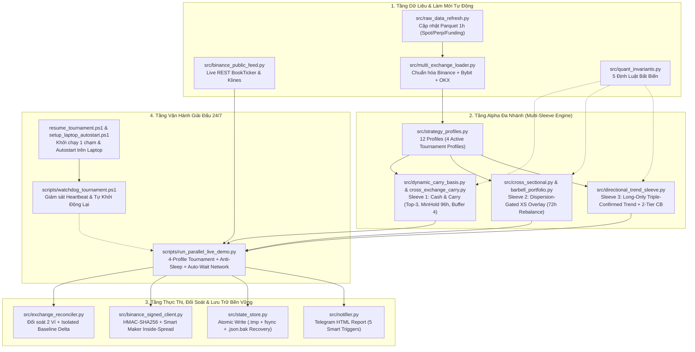

# BÁO CÁO PHÂN TÍCH CHUYÊN SÂU HỆ THỐNG GIAO DỊCH ĐỊNH LƯỢNG (CODEBASE DEEP DIVE)

> **Phiên bản kiến trúc**: Sprint 28 + Nâng cấp Vận hành 24/7 Chu kỳ 105 (Multi-Sleeve Barbell & 4-Profile 24/7 Live Tournament Engine)  
> **Trạng thái kiểm thử**: **859 / 859 Unit & Integration Tests PASSED (100%)**  
> **Trạng thái vận hành**: Chu kỳ 105 (`SYNCED`), sẵn sàng treo 24/7 trên PC / Laptop với cơ chế chống Sleep, chống sập nguồn (`.bak` + `fsync`), tự chờ mạng phục hồi và cảnh báo Telegram thông minh.  
> ** Mục tiêu thiết kế**: Kiến trúc Giao dịch Định lượng Đa chiến lược (Multi-Sleeve Quantitative Portfolio) kết hợp thu hoạch **Delta-Neutral Cash & Carry**, **Cross-Sectional Relative-Value Overlay**, và **Long-Only Triple-Confirmed Trend Sleeve** trên rổ 12 tài sản thanh khoản cao nhất sàn Binance (Spot & USDⓈ-M Futures) cùng dữ liệu liên sàn Bybit & OKX.

---

## MỤC LỤC
1. [Tầm Nhìn Kiến Trúc & Lộ Trình Tiến Hóa (Sprint 1 $\rightarrow$ Sprint 28 & Chu kỳ 105)](#1-tầm-nhìn-kiến-trúc--lộ-trình-tiến-hóa-sprint-1--sprint-28--chu-kỳ-105)
2. [Năm Định Luật Bất Biến Định Lượng (The 5 Non-Negotiable Quant Invariants)](#2-năm-định-luật-bất-biến-định-lượng-the-5-non-negotiable-quant-invariants)
3. [Sơ Đồ Kiến Trúc Tổng Thể & Cấu Trúc Thư Mục](#3-sơ-đồ-kiến-trúc-tổng-thể--cấu-trúc-thư-mục)
4. [Phân Tích Chuyên Sâu Từng Phân Hệ Cốt Lõi (24 Modules trong `src/`)](#4-phân-tích-chuyên-sâu-từng-phân-hệ-cốt-lõi-24-modules-trong-src)
5. [Kiến Trúc Toán Học Đa Chiến Lược & Tinh Gọn Alpha Chu Kỳ 105](#5-kiến-trúc-toán-học-đa-chiến-lược--tinh-gọn-alpha-chu-kỳ-105)
6. [Giải Đấu 4 Profile 24/7, Hạch Toán Cô Lập & Chống Đứt Gãy Vận Hành](#6-giải-đấu-4-profile-247-hạch-toán-cô-lập--chống-đứt-gãy-vận-hành)
7. [Các Cạm Bẫy Thực Chiến Đã Khắc Phục (Battle-Tested Fixes)](#7-các-cạm-bẫy-thực-chiến-đã-khắc-phục-battle-tested-fixes)
8. [Hướng Dẫn Vận Hành & Kiểm Thử Hệ Thống](#8-hướng-dẫn-vận-hành--kiểm-thử-hệ-thống)

---

## 1. TẦM NHÌN KIẾN TRÚC & LỘ TRÌNH TIẾN HÓA (SPRINT 1 $\rightarrow$ SPRINT 28 & CHU KỲ 105)

Hệ thống không phải là một bot chỉ báo kỹ thuật đơn lẻ, mà là một **Institutional-Grade Quantitative Execution & Portfolio Management Engine** đã trải qua 28 Sprint nghiên cứu thực nghiệm và hơn 105 giờ vận hành thực tế liên tục trên Binance Testnet:

1. **Giai đoạn I (Sprint 1 – Sprint 9): Khám phá sự thật về Chi phí Giao dịch & Chuyển dịch sang Cash & Carry**
   - Kiểm định thực nghiệm chứng minh các chiến lược đảo chiều/xu hướng tần suất cao ($1\text{h}$) trên đơn tài sản bị bào mòn bởi phí Taker + trượt giá ($\approx 20\text{ bps}$ mỗi vòng lệnh).
   - Chuyển trọng tâm sang thu hoạch **Funding Rate & Perpetual Basis** thông qua cấu trúc **Delta-Neutral Cash & Carry** (Mua Spot + Bán khống Perp 1:1).

2. **Giai đoạn II (Sprint 10 – Sprint 22): Kiến trúc Barbell, Đa sàn & Thực thi Chuẩn Quỹ (Production Execution)**
   - Tích hợp dữ liệu đa sàn (**Binance, Bybit, OKX**) qua `src/multi_exchange_loader.py` và làm mới dữ liệu Parquet tự động mỗi chu kỳ qua `src/raw_data_refresh.py`.
   - Thiết kế danh mục **Barbell (`src/barbell_portfolio.py`)**: Kết hợp lõi Carry an toàn với nhánh **Cross-Sectional Dispersion-Gated Momentum Overlay** trung hòa Đô-la tuyệt đối.
   - Xây dựng trình kết nối sàn chuẩn HMAC-SHA256 (`src/binance_signed_client.py`) với cơ chế đặt lệnh **Inside-Spread Smart Maker (`LIMIT_MAKER` / `GTX`)**, tự động phòng vệ hai chân (Dual-Leg Rollback) và đối soát tài khoản (`src/exchange_reconciler.py`).

3. **Giai đoạn III (Sprint 23 – Sprint 28): Mở rộng Đa Nhánh Alpha (Multi-Sleeve) & Giải Đấu 4 Profile 24/7**
   - Bổ sung nhánh **Triple-Confirmed Directional Trend (`src/directional_trend_sleeve.py`)** kết hợp cổng xác nhận đa khung ($14\text{d}/21\text{d}/30\text{d}$), bộ lọc quá nhiệt Funding và cầu chì ngắt mạch sụt giảm 2 tầng (**2-Tier Drawdown Circuit Breaker**).
   - Xây dựng hệ thống đăng ký cấu hình chiến lược (`src/strategy_profiles.py` với 12 profiles) và động cơ giải đấu song song 4 cấu hình `$1,000` (`scripts/run_parallel_live_demo.py`): 1 profile bắn lệnh thật trên Binance Testnet (`regime_omni_1k`) đấu trực tiếp với 3 profile chạy giả lập thời gian thực (`flexible_regime_1k`, `carry_max_eta_1k`, `baseline_1k`).
   - Thiết lập cơ chế **Isolated Baseline Delta Accounting (`testnet_baseline.json`)** để bóc tách chính xác PnL của riêng giải đấu khỏi số dư 10,000 USDT mặc định và các vị thế có sẵn trên ví Testnet.

4. **Giai đoạn IV (Chu kỳ 105): Tinh Gọn Alpha Thực Chiến & Chống Đứt Gãy Toàn Diện (24/7 Laptop/PC Hardening)**
   - **Tinh gọn Alpha (Alpha Pruning)**: Sau 104 giờ chạy thực tế và kiểm chứng dữ liệu lịch sử 2022–2026, hệ thống đã tắt hoàn toàn nhánh Reversal (`enable_reversal_sleeve = False`) và tắt chiều Short của nhánh Trend (`allow_short_trend = False`), giảm vòng quay danh mục (`carry_min_hold_bars = 96`, `carry_buffer_rank = 4`, `overlay_rebalance_hours = 72`, `trend_z_entry = 1.25`). Kết quả backtest đạt **+41.78% Pure Alpha (+72.52% kèm lãi tiền nhàn rỗi), Sharpe 1.24, MaxDD -6.68%**.
   - **Chống đứt gãy 24/7**: Bổ sung ngăn Windows tự Sleep (`prevent_windows_sleep`), sao lưu & tự phục hồi trạng thái từ `.json.bak` khi sập nguồn, tự chờ mạng Wi-Fi/Internet phục hồi (`wait_for_network_connectivity`), báo cáo Telegram HTML thông minh theo 5 mốc sự kiện và bảng điểm Terminal Unicode/ANSI trực quan.

---

## 2. NĂM ĐỊNH LUẬT BẤT BIẾN ĐỊNH LƯỢNG (THE 5 NON-NEGOTIABLE QUANT INVARIANTS)

Mọi tính toán và kiểm thử trong toàn bộ codebase đều bị ràng buộc bởi module [`src/quant_invariants.py`](file:///d:/Quant_trading/src/quant_invariants.py):

### Định luật 1: Không Ăn Gian Tương Lai (Strict Causal Execution Alignment)
Mọi đặc trưng (Features), Z-Score, phân vị (Quantile) hoặc mô hình học máy tính tại nến $t$ chỉ được phép sử dụng thông tin trong tập $\mathcal{F}_t = \{X_s : s \le t\}$. Quyết định vị thế $w_t$ chỉ được khớp lệnh từ mở cửa nến $t+1$, hưởng tỷ suất sinh lời $r_{t+1} = \frac{P_{t+1} - P_t}{P_t}$:
$$\text{PnL}_{t+1} = w_t \cdot r_{t+1} \quad (\text{Strict } t \rightarrow t+1 \text{ Shift})$$

### Định luật 2: Tính Đúng Phí Giao Dịch Hai Chiều (Exact Turnover Cost Accounting)
Mỗi lần thay đổi tỷ trọng danh mục đều bị trừ phí và trượt giá theo đúng khối lượng luân chuyển tuyệt đối:
$$\text{Turnover}_t = \sum_{i=1}^{N} \left| w_{i,t} - w_{i,t-1} \right|, \qquad \text{Cost}_t = \text{Turnover}_t \times \left(\text{Fee}_{\text{rate}} + \text{Slippage}_{\text{rate}}\right)$$

### Định luật 3: Không Nhân Đôi Lãi Funding & Basis (No Double Counting)
Trong hợp đồng tương lai vĩnh cửu (Perpetual Futures), tổng lợi nhuận của cặp vị thế Mua Spot $P^S$ và Bán khống Perp $P^P$ gồm hai nguồn độc lập:
1. **Dòng tiền thanh toán Funding định kỳ mỗi 8 giờ**:
   $$\text{CF}^{\text{funding}}_t = Q_{\text{perp}} \cdot P^P_t \cdot f_t \cdot \mathbb{I}(\text{8h Settlement})$$
2. **Hội tụ giá chênh lệch Basis (Mark-to-Market)**:
   $$\Delta \text{Basis}_t = \left(P^S_t - P^S_{t-1}\right) - \left(P^P_t - P^P_{t-1}\right)$$
Hệ thống hạch toán tách biệt hai dòng tiền này (`cum_funding_usd` và `cum_basis_usd`), tuyệt đối không cộng gộp sai bản chất.

### Định luật 4: Lịch Tái Cân Bằng Bất Biến Theo Mốc Giờ Quốc Tế (Stateless UTC Epoch Rebalance Clock)
Không dùng phép chia lấy dư trên chỉ số mảng cục bộ (`i % 48 == 0`) vì nếu mạng đứt 1 nến, lịch tái cân bằng sẽ bị trôi pha vĩnh viễn. Hệ thống dùng mốc giờ UTC tuyệt đối tính từ `1970-01-01T00:00:00Z`:
$$h_t = \left\lfloor \frac{\text{Timestamp}_t (\text{ns})}{3.6 \times 10^{12}} \right\rfloor, \qquad \text{Trigger}_t \iff \left\lfloor \frac{h_t}{K} \right\rfloor > \left\lfloor \frac{h_{t-1}}{K} \right\rfloor$$

### Định luật 5: Trung Hòa Đô-la Sau Làm Tròn Lô Sàn (Post-Rounding Dollar Neutrality)
Sau khi quy đổi ra số lượng coin thực tế và cắt gọt theo `stepSize` của sàn ($\text{floor}(q / \Delta q) \cdot \Delta q$), tổng giá trị Đô-la của chân Mua và chân Bán trong nhánh Market-Neutral phải thỏa mãn:
$$\left| \sum_{i \in \text{Long}} Q_i^{\text{lot}} P_i - \sum_{j \in \text{Short}} Q_j^{\text{lot}} P_j \right| \le \tau_{\text{USD}} \quad (\tau_{\text{USD}} = \$10.0)$$

---

## 3. SƠ ĐỒ KIẾN TRÚC TỔNG THỂ & CẤU TRÚC THƯ MỤC



### Cấu trúc thư mục dự án:
```text
d:\Quant_trading\
├── src/                                  # 24 Module lõi của hệ thống
│   ├── config.py                         # Cấu hình hằng số, rổ 12 coin, quy tắc LOT_SIZE/MIN_NOTIONAL
│   ├── quant_invariants.py               # 5 định luật bất biến toán học & kiểm định nhân quả
│   ├── data_loader.py                    # Tải và căn chỉnh dữ liệu nến OHLCV (Spot & Perp)
│   ├── funding_loader.py                 # Tải dữ liệu Funding Rate và tính Z-Score nhân quả
│   ├── multi_exchange_loader.py          # Hợp nhất dữ liệu 3 sàn (Binance, Bybit, OKX)
│   ├── raw_data_refresh.py               # Tự động tải bù nến 1h và Funding mới nhất vào Parquet đầu mỗi chu kỳ
│   ├── features.py                       # Trích xuất đặc trưng kỹ thuật và biến động thực tế (Realized Vol)
│   ├── strategy.py                       # Chiến lược đơn tài sản cơ sở (Baseline Strategy)
│   ├── carry_strategy.py                 # Hạch toán dòng tiền Delta-Neutral Cash & Carry cơ bản
│   ├── cross_sectional.py                # Động cơ xếp hạng Momentum thiết diện ngang & kiểm định Newey-West
│   ├── dynamic_carry_basis.py            # Chọn lọc động Top-K Carry dựa trên Composite Score (Funding + Basis)
│   ├── cross_exchange_carry.py           # Phân bổ Carry đa sàn, kiểm soát Margin Buffer & chống dồn cục
│   ├── barbell_portfolio.py              # Ghép nối Barbell: Core Carry + Dispersion-Gated XS Overlay
│   ├── directional_trend_sleeve.py       # Nhánh Trend thuận xu hướng 3 tầng (14d/21d/30d) + Cầu chì 2-Tier CB
│   ├── stat_arb_sleeve.py                # Nhánh đảo chiều có điều kiện Funding (đã tắt ở Chu kỳ 105 để bảo toàn Alpha)
│   ├── strategy_profiles.py              # Registry 12 cấu hình chiến lược ($1,000 profiles)
│   ├── risk_manager.py                   # Quản trị rủi ro vị thế, giới hạn đòn bẩy và cắt lỗ
│   ├── ml_filter.py                      # Bộ lọc phân loại xác suất học máy Walk-Forward
│   ├── backtester.py                     # Động cơ mô phỏng lịch sử vector hóa chuẩn xác
│   ├── state_store.py                    # Lưu trữ trạng thái nguyên tử (.tmp -> fsync -> .bak -> replace)
│   ├── binance_public_feed.py            # Kết nối REST công khai lấy giá Bid/Ask và nến trực tiếp
│   ├── binance_signed_client.py          # Kết nối ký lệnh HMAC-SHA256, Smart Maker, chống treo mạng
│   ├── exchange_reconciler.py            # Đối soát trạng thái ví thực tế & Hạch toán cô lập (Isolated Baseline)
│   ├── carry_live_executor.py            # Vòng lặp điều phối thực thi Barbell trực tiếp
│   ├── live_executor.py                  # Vòng lặp điều phối thực thi đơn chiến lược
│   └── notifier.py                       # Báo cáo Telegram HTML chuyên nghiệp theo 5 mốc thông minh
├── scripts/                              # Các kịch bản vận hành, giải đấu, nghiên cứu & kiểm tra an toàn
│   ├── run_parallel_live_demo.py         # Động cơ giải đấu 4 Profile $1,000 chạy 24/7 (Terminal UI + Resilience)
│   ├── watchdog_tournament.ps1           # Tiến trình canh gác tự động khởi động lại nếu bot treo
│   ├── setup_laptop_autostart.ps1        # Đăng ký Windows Scheduled Task tự bật giải đấu khi khởi động máy
│   ├── run_1k_profile_tournament_backtest.py # Backtest so sánh hiệu năng các profile $1,000
│   ├── evaluate_recent_holdout.py        # Kiểm định Out-of-Sample trên dữ liệu 90-180 ngày gần nhất
│   ├── run_testnet_preflight.py          # Kiểm tra 6 cổng an toàn trước khi giao dịch thật
│   └── check_testnet_equity_breakdown.py # Kiểm tra nhanh số dư Spot/Futures Testnet (Read-only)
├── tests/                                # 30 file kiểm thử tự động (859 test cases đạt 100% PASS)
├── data/
│   ├── raw/                              # Dữ liệu Parquet lịch sử 12 coin (tự động cập nhật mỗi giờ)
│   └── state/                            # Trạng thái sống của giải đấu (Chu kỳ 105 SYNCED + .bak dự phòng)
├── run_live.py                           # CLI chạy đơn chiến lược trực tiếp
├── run_backtest.py                       # CLI chạy kiểm thử lịch sử chuẩn
└── resume_tournament.ps1                 # Script 1 chạm khởi động lại giải đấu 24/7 + Watchdog
```

---

## 4. PHÂN TÍCH CHUYÊN SÂU TỪNG PHÂN HỆ CỐT LÕI (24 MODULES TRONG `src/`)

### 4.1. Nhóm Cấu hình, Định luật & Dữ liệu (`config.py`, `quant_invariants.py`, `raw_data_refresh.py`, `multi_exchange_loader.py`)
- **[`src/config.py`](file:///d:/Quant_trading/src/config.py)**: Định nghĩa danh mục 12 tài sản chuẩn (`CANONICAL_UNIVERSE_SYMBOLS`: `BTCUSDT`, `ETHUSDT`, `SOLUSDT`, `BNBUSDT`, `XRPUSDT`, `ADAUSDT`, `DOGEUSDT`, `AVAXUSDT`, `DOTUSDT`, `LINKUSDT`, `MATICUSDT`/`POLUSDT`, `LTCUSDT`), bảng quy chuẩn bước giá (`LOT_SIZE`, `MIN_NOTIONAL`) và các thông số vốn, phí.
- **[`src/raw_data_refresh.py`](file:///d:/Quant_trading/src/raw_data_refresh.py)**: Ở đầu mỗi chu kỳ của giải đấu 24/7, hàm [`refresh_canonical_raw_data`](file:///d:/Quant_trading/src/raw_data_refresh.py#L180-L260) tự động truy vấn phần nến 1h còn thiếu từ mốc cuối cùng trong file Parquet đến thời điểm hiện tại cho cả 12 cặp Spot, 12 cặp Perp và lịch sử Funding Rate, giúp tín hiệu định lượng luôn liền mạch mà không phải tải lại từ đầu.
- **[`src/multi_exchange_loader.py`](file:///d:/Quant_trading/src/multi_exchange_loader.py)**: Đồng bộ hóa dữ liệu từ 3 sàn **Binance, Bybit, OKX** về cùng lưới thời gian 1 giờ UTC, chuẩn hóa Funding Rate từ chu kỳ 8h về tỷ lệ hàng giờ để so sánh công bằng.

### 4.2. Nhóm Chiến lược Đa Nhánh (`dynamic_carry_basis.py`, `barbell_portfolio.py`, `directional_trend_sleeve.py`, `strategy_profiles.py`)
- **[`src/dynamic_carry_basis.py`](file:///d:/Quant_trading/src/dynamic_carry_basis.py) & [`src/cross_exchange_carry.py`](file:///d:/Quant_trading/src/cross_exchange_carry.py)**: Tính toán lợi suất kỳ vọng của vị thế Cash & Carry từ trung bình trượt Funding Rate (72h/168h) kết hợp tốc độ hội tụ Basis. Áp dụng cơ chế **Hysteresis Buffer (`carry_buffer_rank = 4`)** và thời gian nắm giữ tối thiểu (`carry_min_hold_bars = 96` giờ) để tránh đảo danh mục khi thứ hạng chênh lệch nhỏ.
- **[`src/barbell_portfolio.py`](file:///d:/Quant_trading/src/barbell_portfolio.py)**: Điều phối phân bổ vốn giữa Lõi Carry và Nhánh **Cross-Sectional Momentum Overlay**. Tích hợp bộ lọc **Dispersion SNR Gate** (chỉ bật Overlay khi độ phân tán lợi suất giữa các đồng coin đủ lớn) và hàm [`enforce_overlay_dollar_neutrality`](file:///d:/Quant_trading/src/barbell_portfolio.py#L430-L510) để ép độ lệch Long/Short sau khi làm tròn lô xuống dưới $\$10$.
- **[`src/directional_trend_sleeve.py`](file:///d:/Quant_trading/src/directional_trend_sleeve.py)**:
  - Tính điểm xu hướng chuẩn hóa biến động trên 3 khung thời gian: Ngắn hạn ($336\text{h} = 14\text{d}$), Trung hạn ($504\text{h} = 21\text{d}$) và Dài hạn ($720\text{h} = 30\text{d}$).
  - **Cổng đồng thuận 3 tầng (Triple Confirmation)**: Chỉ mở vị thế khi cả 3 khung thời gian cùng dương và điểm tổng hợp vượt ngưỡng `trend_z_entry = 1.25`.
  - **Chế độ Long-Only (`allow_short_trend = False`)**: Chỉ bắt sóng tăng giá thực sự của thị trường Crypto, loại bỏ rủi ro Short Squeeze.
  - **Cầu chì sụt giảm 2 tầng (`compute_trend_sleeve_circuit_breaker`)**: Tự động giảm nửa quy mô khi nhánh Trend sụt giảm chạm ngưỡng Tier 1 ($2.5\%$) và đóng băng nghỉ ngơi (`COOLDOWN`) khi chạm ngưỡng Tier 2 ($4.5\%$).
- **[`src/strategy_profiles.py`](file:///d:/Quant_trading/src/strategy_profiles.py)**: Quản lý 12 cấu hình chiến lược trong `PROFILE_REGISTRY`, nổi bật là 4 cấu hình đang thi đấu trực tiếp:
  1. `regime_omni_1k` (**TESTNET_REAL**): Đa nhánh thích ứng theo chế độ thị trường (Carry + XS Overlay + Long-Only Trend).
  2. `flexible_regime_1k` (**SHADOW_LIVE**): Đa nhánh linh hoạt với tỷ trọng co giãn mượt.
  3. `carry_max_eta_1k` (**SHADOW_LIVE**): Tập trung tối đa vào thu hoạch Carry + XS Overlay, không dùng Trend (`Trend CB = N/A (No-Trend)`).
  4. `baseline_1k` (**SHADOW_LIVE**): Danh mục chuẩn đối chiếu (85% Carry / 15% Overlay cố định, `Trend CB = N/A (No-Trend)`).

### 4.3. Nhóm Thực thi, Đối soát & Lưu trữ Bền vững (`binance_signed_client.py`, `exchange_reconciler.py`, `state_store.py`, `notifier.py`)
- **[`src/binance_signed_client.py`](file:///d:/Quant_trading/src/binance_signed_client.py)**:
  - Ký xác thực HMAC-SHA256 cho cả Spot Testnet và USDⓈ-M Futures Testnet, tự động bù độ lệch đồng hồ server (`sync_server_time`) chống lỗi `-1021`.
  - Đặt lệnh **Inside-Spread Smart Maker** (`compute_maker_limit_price`) ưu tiên hưởng phí Maker thấp; tự động chuyển sang lệnh Market khi hết thời gian chờ.
  - **Chống treo vô hạn (Anti-Hang Monotonic Ceiling)**: Hàm [`wait_for_order_fill`](file:///d:/Quant_trading/src/binance_signed_client.py#L430-L510) sử dụng `time.monotonic()` với trần cứng `max_total_wait_sec = 45.0s`, ngăn chặn triệt để hiện tượng treo tiến trình nếu API Binance phản hồi chậm.
  - **Không dùng `reduceOnly` trên tài khoản Futures 1 chiều dùng chung**: Cho phép đảo chiều mượt mà giữa vị thế Carry (Short Perp) và vị thế Overlay/Trend (Long Perp) mà không bị sàn từ chối với lỗi `-2022 ReduceOnly Order is rejected`.
- **[`src/exchange_reconciler.py`](file:///d:/Quant_trading/src/exchange_reconciler.py)**:
  - Đối soát toàn diện vị thế và số dư giữa sổ cái nội bộ và sàn Binance.
  - **Hạch toán cô lập (`compute_isolated_testnet_equity`)**: Lưu trữ ảnh chụp tài khoản ban đầu vào `testnet_baseline.json` và tính toán PnL thực tế của bot dựa trên độ chênh lệch vị thế và tiền mặt ($\Delta \text{Cash} + \Delta \text{Position}$), tách biệt hoàn toàn gói vốn `$1,000` của bot khỏi số dư 10,000 USDT mặc định của sàn Testnet.
- **[`src/state_store.py`](file:///d:/Quant_trading/src/state_store.py)**:
  - Ghi file trạng thái nguyên tử: Ghi vào `.tmp` $\rightarrow$ `f.flush()` + `os.fsync(f.fileno())` $\rightarrow$ sao lưu file `.json` hiện tại sang `.json.bak` $\rightarrow$ `os.replace()`.
  - Khi đọc (`load()`), nếu file `.json` chính bị lỗi cú pháp hoặc 0-byte do mất điện đột ngột, hệ thống tự động khôi phục từ `.json.bak` và ghi cảnh báo `WARNING: RECOVERED_STATE_FROM_BACKUP`.
- **[`src/notifier.py`](file:///d:/Quant_trading/src/notifier.py)**:
  - Định dạng báo cáo Telegram bằng **HTML (`parse_mode="HTML"`)** với bảng `<pre>` căn cột gọn gàng trên màn hình điện thoại, tự động fallback về văn bản thuần nếu gặp lỗi cú pháp thẻ HTML.
  - Cơ chế lọc thông minh [`should_send_tournament_telegram`](file:///d:/Quant_trading/src/notifier.py#L220-L280) chỉ gửi tin nhắn ở 5 mốc quan trọng (Khởi động/Resume, Có lệnh khớp mới, Mạng vừa phục hồi, Cảnh báo rủi ro/lệch đối soát, và Định kỳ mỗi $N$ chu kỳ hoặc 00:00 UTC).

---

## 5. KIẾN TRÚC TOÁN HỌC ĐA CHIẾN LƯỢC & TINH GỌN ALPHA CHU KỲ 105

Tại mỗi chu kỳ tái cân bằng, tổng vốn danh mục $E_t$ được phân bổ linh hoạt vào 4 nguồn sinh lời:

$$\text{Total Equity Return} = \underbrace{R_{\text{Carry}}}_{\text{Funding + Basis}} + \underbrace{R_{\text{XS Overlay}}}_{\text{Market-Neutral}} + \underbrace{R_{\text{Trend (Long-Only)}}}_{\text{Triple-Confirmed Breakout}} + \underbrace{R_{\text{Idle Cash Yield}}}_{\text{4.5\% APR Earn}}$$

### Bảng thông số Tinh gọn Alpha từ Chu kỳ 105 (`regime_omni_1k` & `flexible_regime_1k`):
| Thành phần | Trước Chu kỳ 105 | Sau Chu kỳ 105 (Hiện tại) | Lý do Định lượng & Thực nghiệm |
| :--- | :--- | :--- | :--- |
| **Nhánh Reversal (`enable_reversal_sleeve`)** | Bật (`True`) | **Tắt (`False`)** | Giao dịch đảo chiều ngắn hạn bị phí giao dịch ăn mòn âm PnL trong cả thực tế lẫn backtest. |
| **Chiều Short của Trend (`allow_short_trend`)** | Cho phép Short | **Chỉ đánh Long (`False`)** | Crypto có độ lệch dương (positive skew); Short xu hướng dễ dính bẫy Short Squeeze khi thị trường hồi phục chữ V. |
| **Ngưỡng vào lệnh Trend (`trend_z_entry`)** | $0.85 - 1.00$ | **$1.25$** | Chỉ giải ngân khi xu hướng tăng thực sự mạnh trên cả 3 khung 14d/21d/30d. |
| **Số cặp Carry (`carry_top_k`) & Đệm (`buffer_rank`)** | Top 2, Buffer 3 | **Top 3, Buffer 4** | Đa dạng hóa thu hoạch Funding trên 3 đồng coin tốt nhất, chỉ đảo vị thế khi văng khỏi Top 4. |
| **Chu kỳ giữ Carry (`carry_min_hold_bars`)** | 48 giờ | **96 giờ (4 ngày)** | Giảm một nửa chi phí đảo chân Spot/Perp, giữ trọn vẹn chuỗi Funding dương. |
| **Chu kỳ tái cân bằng Overlay (`overlay_rebalance_hours`)** | 24 – 48 giờ | **72 giờ (3 ngày)** | Giảm nhiễu giao dịch thiết diện ngang, tối ưu hóa tỷ lệ Alpha / Chi phí. |

---

## 6. GIẢI ĐẤU 4 PROFILE 24/7, HẠCH TOÁN CÔ LẬP & CHỐNG ĐỨT GÃY VẬN HÀNH

Script [`scripts/run_parallel_live_demo.py`](file:///d:/Quant_trading/scripts/run_parallel_live_demo.py) vận hành giải đấu 24/7 với 5 lớp bảo vệ cấp độ Production:

1. **Ngăn Windows tự Sleep (`prevent_windows_sleep`)**: Gọi trực tiếp Win32 API `SetThreadExecutionState(ES_CONTINUOUS | ES_SYSTEM_REQUIRED)` khi khởi chạy và lặp lại ở đầu mỗi chu kỳ, đảm bảo Laptop luôn thức để chạy bot ngay cả khi tắt màn hình.
2. **Tự động chờ mạng phục hồi (`wait_for_network_connectivity`)**: Nếu Wi-Fi hoặc đường truyền Internet bị rớt ở đầu chu kỳ, bot tự động chuyển trạng thái Heartbeat sang `WAITING_FOR_NETWORK` và thử kết nối lại mỗi 15 giây (tối đa 5 phút) thay vì báo lỗi chu kỳ ngay lập tức. Khi mạng có lại, bot gửi thông báo `[NETWORK RECOVERED]` qua Telegram và chạy tiếp chu kỳ bình thường.
3. **Chống hỏng file trạng thái khi sập nguồn (`fsync` + `.json.bak`)**: Mọi file sổ cái (`demo_Scoreboard_state.json`, `demo_*_ledger.json`, `tournament_heartbeat.json`) đều được ép ghi xuống đĩa vật lý bằng `os.fsync` và giữ bản sao `.bak` của chu kỳ hợp lệ liền trước.
4. **Canh gác độc lập (`scripts/watchdog_tournament.ps1`)**: Kiểm tra tuổi của file `data/state/tournament_heartbeat.json` mỗi 5 phút. Nếu tiến trình Python bị treo quá ngưỡng cho phép, Watchdog tự động thu hồi tiến trình cũ và khởi chạy lại từ trạng thái đã lưu.
5. **Giao diện Bảng điểm Terminal Trực quan**: Hiển thị bảng khung viền Unicode (`╔═╦═╗`) phối màu ANSI sắc nét, phân biệt rõ cột `Trend CB` (`N/A (No-Trend)` cho các profile không dùng nhánh Trend vs `ACTIVE (Tier 0)` cho các profile có nhánh Trend), danh sách vị thế thực tế, độ lệch đối soát `recon_drift_usd` và đồng hồ đếm ngược tới chu kỳ kế tiếp.

---

## 7. CÁC CẠM BẪY THỰC CHIẾN ĐÃ KHẮC PHỤC (BATTLE-TESTED FIXES)

1. **Cạm bẫy lỗi `-2022 ReduceOnly Order is rejected` khi kết hợp nhiều nhánh Alpha**:
   - *Hiện tượng*: Khi tài khoản Futures ở chế độ One-Way Mode vừa giữ lệnh Short Perp của nhánh Carry, vừa nhận lệnh Long Perp từ nhánh Trend/Overlay, việc gắn cờ `reduceOnly=True` bị Binance từ chối khi quy mô lệnh đảo chiều vượt quá vị thế hiện tại.
   - *Giải pháp*: Quản lý vị thế theo **Target Net Futures Position** tổng hợp của tất cả các nhánh và gửi lệnh điều chỉnh chênh lệch ($\Delta Q$) không dùng cờ `reduceOnly`, kèm kiểm tra số dư ký quỹ trước khi đặt lệnh.
2. **Cạm bẫy bụi lẻ `LOT_SIZE` trên Spot Testnet**:
   - *Hiện tượng*: Sau nhiều chu kỳ mua bán, ví Spot còn sót lại phần lẻ nhỏ hơn bước nhảy `stepSize` hoặc nhỏ hơn `MIN_NOTIONAL` ($5–$10), khiến Reconciler báo lệch hoặc lệnh bán bị từ chối `-1013`.
   - *Giải pháp*: Tích hợp bộ lọc `quantize_spot_close_qty` và dung sai đối soát thông minh, tự động bỏ qua phần bụi dưới ngưỡng giao dịch tối thiểu của sàn.
3. **Cạm bẫy treo tiến trình vô hạn khi API Testnet nghẽn**:
   - *Hiện tượng*: Vòng lặp chờ khớp lệnh hoặc gọi REST bị treo hàng giờ khi máy chủ Testnet phản hồi chậm, làm đứt chuỗi chu kỳ 1h.
   - *Giải pháp*: Áp dụng trần thời gian đơn điệu (`time.monotonic()`) tối đa 45 giây cho mọi vòng lặp chờ lệnh và cơ chế Watchdog kiểm tra Heartbeat độc lập.
4. **Cạm bẫy hỏng file JSON khi mất điện đột ngột**:
   - *Hiện tượng*: Sập nguồn đúng lúc đang ghi file trạng thái có thể tạo ra file JSON 0-byte hoặc mất dấu đóng ngoặc, làm bot không thể khởi động lại.
   - *Giải pháp*: Cơ chế Atomic Write kết hợp `os.fsync()` và tự động fallback sang file `.json.bak` (`WARNING: RECOVERED_STATE_FROM_BACKUP`).

---

## 8. HƯỚNG DẪN VẬN HÀNH & KIỂM THỬ HỆ THỐNG

### 8.1. Tiếp tục chạy Giải đấu 24/7 từ Chu kỳ 105 (Khuyên dùng)
```powershell
powershell -ExecutionPolicy Bypass -File .\resume_tournament.ps1
```

### 8.2. Đăng ký Tự khởi động Giải đấu khi bật Laptop
```powershell
powershell -ExecutionPolicy Bypass -File .\scripts\setup_laptop_autostart.ps1
```

### 8.3. Chạy trực tiếp Giải đấu trên Terminal (kèm tùy chỉnh tần suất báo cáo Telegram)
```powershell
python scripts/run_parallel_live_demo.py --interval-sec 3600 --tg-report-every 4
```

### 8.4. Chạy toàn bộ 859 bài kiểm thử tự động (Unit & Integration Tests)
```powershell
pytest -q
```
