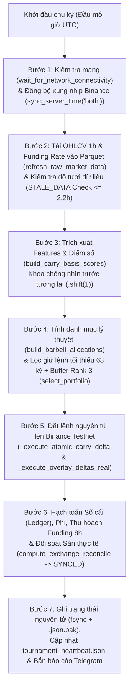

# TÀI LIỆU TỔNG QUAN CHIẾN LƯỢC, TOÁN HỌC ĐỊNH LƯỢNG & LUỒNG GIAO DỊCH THỰC TẾ (END-TO-END TRADING BLUEPRINT)

> **Phiên bản kiến trúc**: Post-Sprint 27 Champion Baseline (U4 + U5 + U3) (Cập nhật ngày `02/11/2026`)
> **Vai trò biên soạn**: Chief Quant Architect (Kiến trúc sư trưởng Định lượng)
> **Vốn khởi tạo giải đấu**: `$1,000.00 USDT` / Profile (Split-Wallet: Ví Spot + Ví USDⓈ-M Futures)
> **Rổ tài sản mục tiêu (`LIQUID_8_SYMBOLS`)**: `BTC/USDT:USDT`, `ETH/USDT:USDT`, `SOL/USDT:USDT`, `BNB/USDT:USDT`, `DOGE/USDT:USDT`, `XRP/USDT:USDT`, `AVAX/USDT:USDT`, `LINK/USDT:USDT` (Đã kiểm định Falsification: Giữ nguyên rổ 8 đồng, bác bỏ U6 mở rộng 12 đồng)
> **Gói nâng cấp chiến thắng (Champion Upgrades)**:
> - **`U4` Maker-First Blended Cost**: `9.25 bps/chiều` (`18.5 bps` khứ hồi), giữ nguyên `entry_threshold = 0.45 bps`.
> - **`U5` Tối ưu hóa Split-Wallet**: `carry_max_eta_1k` tái cơ cấu `$700.00` Spot / `$300.00` Futures (`carry_eta = 0.78`) giải phóng kẹp trần Futures (`$300 * 3.0x = $900 > $780`), kết hợp cơ chế `dynamic_transfer_flat` khi Trend=FLAT.
> - **`U3` Emergency Negative Funding Exit**: Thoát sớm sau 12 kỳ nếu $f_{ewma} < -1.0 \text{ bps/8h}$ bảo vệ vốn trong kịch bản sập funding âm.
> > **Nguồn tham chiếu trực tiếp**: [`src/strategy_profiles.py`](../src/strategy_profiles.py), [`src/carry_strategy.py`](../src/carry_strategy.py), [`src/dynamic_carry_basis.py`](../src/dynamic_carry_basis.py), [`src/barbell_portfolio.py`](../src/barbell_portfolio.py), [`src/directional_trend_sleeve.py`](../src/directional_trend_sleeve.py), [`src/carry_live_executor.py`](../src/carry_live_executor.py), [`src/quant_invariants.py`](../src/quant_invariants.py), [`scripts/run_parallel_live_demo.py`](../scripts/run_parallel_live_demo.py)

---

## PHẦN 1: BỨC TRANH TỔNG THỂ & ĐỘI HÌNH 4 PROFILE ĐANG CHẠY GIẢI ĐẤU ($1,000 USDT)

Hệ thống vận hành một giải đấu định lượng song song 24/7 ([`scripts/run_parallel_live_demo.py`](../scripts/run_parallel_live_demo.py) được giám sát bởi tiến trình canh gác [`resume_tournament.ps1`](../resume_tournament.ps1)) gồm **4 cấu hình chiến lược (Profiles)** cùng xuất phát từ mốc vốn **`$1,000.00 USDT`**.

Do Binance tách biệt số dư giữa ví **Spot** và ví **USDⓈ-M Futures**, mỗi Profile áp dụng kiến trúc **Split-Wallet** ([`StrategyProfileConfig`](../src/strategy_profiles.py#L22-L120)):
- **Ví Spot (`spot_wallet_usd`)**: Dùng để mua tài sản cơ sở làm chân **Long Spot** của chiến lược Carry (không dùng đòn bẩy, tối đa 100% số dư ví Spot).
- **Ví Futures (`futures_wallet_usd`)**: Dùng làm tài sản ký quỹ chung (Shared Margin Collateral) cho chân **Short Perp** của Carry, cộng thêm các lớp Alpha (**XS Momentum Overlay** và **Directional Trend Sleeve**) với trần đòn bẩy gộp `max_futures_leverage`.

### 1.1. Bảng so sánh cấu hình & trạng thái các Nhánh chiến lược (Sleeves) của 4 Profile

Toàn bộ con số dưới đây được trích xuất **chính xác 100%** từ hàm [`_build_registry()`](../src/strategy_profiles.py#L123-L527) trong [`src/strategy_profiles.py`](../src/strategy_profiles.py):

| Thông số kỹ thuật / Nhánh (Sleeve) | `regime_omni_1k` *(Chủ lực Đa chế độ)* | `flexible_regime_1k` *(Đa chế độ Linh hoạt)* | `carry_max_eta_1k` *(Tối đa hóa Carry - Sprint 27 U5)* | `baseline_1k` *(Chuẩn tham chiếu Bảo thủ)* |
| :--- | :--- | :--- | :--- | :--- |
| **Chế độ thực thi (`execution_mode`)** | **`TESTNET_REAL`** *(Đặt lệnh thật lên sàn Binance Testnet)* | **`SHADOW_LIVE`** *(Khớp lệnh giả lập trên giá/funding thật)* | **`SHADOW_LIVE`** *(Khớp lệnh giả lập trên giá/funding thật)* | **`SHADOW_LIVE`** *(Khớp lệnh giả lập trên giá/funding thật)* |
| **Tổng vốn gốc (`initial_capital_usd`)** | `$1,000.00` | `$1,000.00` | `$1,000.00` | `$1,000.00` |
| **Cơ cấu Ví Spot / Ví Futures** | **`$550.00` (55%) / `$450.00` (45%)** | **`$600.00` (60%) / `$400.00` (40%)** | **`$700.00` (70%) / `$300.00` (30%)** *(Đã tối ưu U5)* | **`$650.00` (65%) / `$350.00` (35%)** |
| **Đòn bẩy Futures tối đa (`max_futures_leverage`)** | `3.0x` (Trần Gross Futures: `$1,350.00`) | `3.0x` (Trần Gross Futures: `$1,200.00`) | `3.0x` (Trần Gross Futures: `$900.00` $\ge \$780.00$, 0 clamp) | `2.8x` (Trần Gross Futures: `$980.00`) |
| **Số vị thế Carry tối đa (`carry_top_k`)** | **`3` vị thế** | **`3` vị thế** | **`2` vị thế** | **`3` vị thế** |
| **Hệ số giải ngân Carry (`carry_eta` = $\eta$)** | **`0.55`** (`$550.00` / ~`$183.33` mỗi vị thế) | **`0.60`** (`$600.00` / ~`$200.00` mỗi vị thế) | **`0.78`** (`$780.00` / `$390.00` mỗi vị thế, giải phóng 100%) | **`0.65`** (`$650.00` / ~`$216.67` mỗi vị thế) |
| **Trọng số đơn lẻ tối đa (`carry_max_single_weight`)** | `0.50` (50% ngân sách Carry) | `0.50` (50% ngân sách Carry) | `0.55` (55% ngân sách Carry) | `0.50` (50% ngân sách Carry) |
| **Chế độ chia vốn Carry (`carry_weighting_mode`)** | `"equal"` (`carry_tilt_alpha = 0.0`) | `"equal"` (`carry_tilt_alpha = 0.0`) | `"equal"` (`carry_tilt_alpha = 0.0`) | `"equal"` (`carry_tilt_alpha = 0.0`) |
| **1. Carry Sleeve (Delta-Neutral Funding)** | **BẬT** (`entry = 0.45 bps`, `exit = 0.0 bps`, `hold = 63`, `buf = 3`, `emergency_exit = 12 / -1.0 bps`) | **BẬT** (`entry = 0.45 bps`, `exit = 0.0 bps`, `hold = 63`, `buf = 3`, `emergency_exit = 12 / -1.0 bps`) | **BẬT** (`entry = 0.45 bps`, `exit = 0.0 bps`, `hold = 63`, `buf = 3`, `emergency_exit = 12 / -1.0 bps`) | **BẬT** (`entry = 0.45 bps`, `exit = 0.0 bps`, `hold = 63`, `buf = 3`, `emergency_exit = 12 / -1.0 bps`) |
| **2. XS Momentum Overlay Sleeve** | **BẬT** (`overlay_gross_pct = 0.15` [15%], `target_vol = 7.5%/năm`) | **BẬT** (`overlay_gross_pct = 0.15` [15%], `target_vol = 7.5%/năm`) | **BẬT** (`overlay_gross_pct = 0.15` [15%], `target_vol = 7.5%/năm`) | **TẮT** (`overlay_gross_pct = 0.0`, `target_vol = 0.0` — đã cắt tỉa) |
| **3. Directional Trend Sleeve** | **BẬT** (Long + Short, `max_gross = 65%`, `target_vol = 15%`, `short_scale = 0.75`, `macro_filter = True`, `dynamic_margin = True`, `dynamic_transfer_flat = True`) | **BẬT** (Long + Short, `max_gross = 70%`, `target_vol = 15%`, `short_scale = 0.65`, `macro_filter = True`, `dynamic_margin = True`, `dynamic_transfer_flat = True`) | **TẮT** (`enable_trend_sleeve = False`) | **TẮT** (`enable_trend_sleeve = False`) |
| **4. Stat-Arb Reversal Sleeve** | **TẮT** (`enable_reversal_sleeve = False`, `gross = 0.0` — đã cắt tỉa) | **TẮT** (`enable_reversal_sleeve = False`, `gross = 0.0` — đã cắt tỉa) | **TẮT** (`enable_reversal_sleeve = False`) | **TẮT** (`enable_reversal_sleeve = False`) |
| **5. Passive Cash Yield (Yield Stacking)** | **BẬT** (`BFUSD = 4.5%`, `Idle Spot = 3.5%`, `ETH = 3.2%`, `SOL = 6.2%`) | **BẬT** (`BFUSD = 4.5%`, `Idle Spot = 3.5%`, `ETH = 3.2%`, `SOL = 6.2%`) | **BẬT** (`BFUSD = 4.5%`, `Idle Spot = 3.5%`, `ETH = 3.2%`, `SOL = 6.2%`) | **BẬT** (`BFUSD = 4.5%`, `Idle Spot = 3.5%`, `ETH = 3.2%`, `SOL = 6.2%`) |
| **Cầu dao 2 tầng (`Circuit Breaker`)** | **BẬT** (`Soft DD = 6.0%` $\rightarrow$ giảm 50%; `Hard DD = 10.0%` $\rightarrow$ khóa `168h`) | **BẬT** (`Soft DD = 6.0%` $\rightarrow$ giảm 50%; `Hard DD = 10.0%` $\rightarrow$ khóa `168h`) | **TẮT** (Không dùng Trend) | **TẮT** (Không dùng Trend) |

> **Tối ưu hóa kiến trúc Sprint 27 U5 về `carry_max_eta_1k`:** Profile này đã được tái cấu trúc sang `spot_wallet_usd = $700.0` và `futures_wallet_usd = $300.0` (`carry_eta = 0.78`). Với đòn bẩy `3.0x`, sức chứa ví Futures đạt `$900.00`, hoàn toàn bao phủ ngân sách Carry `$780.00`, giải phóng 100% nút thắt kẹp trần (`cap_bind_count = 0`), đưa Pure APR 24M tăng từ `2.35%` lên `3.55%` (+1.20 pp)!

### 1.2. Hiệu suất Backtest Đa chu kỳ & Holdout đã ghi nhận

Dữ liệu kiểm định từ [`logs/multi_cycle_pruning_evaluation.json`](../logs/multi_cycle_pruning_evaluation.json) (khung 24 tháng `2024-10-31` $\rightarrow$ `2026-10-30`, `17,474` nến 1h và khung 3 tháng gần nhất `2026-07-31` $\rightarrow$ `2026-10-30`, `2,162` nến 1h sau khi áp dụng bản vá cắt tỉa Stat-Arb Reversal) và [`logs/sprint26_high_return_evidence.json`](../logs/sprint26_high_return_evidence.json) (Full 3.5 năm `2023-05-07` $\rightarrow$ `2026-10-19`, `30,265` nến 1h & Holdout 6 tháng):

| Profile | Khung đánh giá | Pure Trading Total Return (%) | Yield-Stacked Total Return (%) | Pure Trading Net APR (%) | Yield-Stacked Net APR (%) | Pure Sharpe / Yield Sharpe | Pure Max Drawdown (%) | Tỷ lệ Tháng Thắng (24M Win Rate) |
| :--- | :--- | :---: | :---: | :---: | :---: | :---: | :---: | :---: |
| **`regime_omni_1k`** *(Sau cắt tỉa)* | **24M (`17,474h`)** **Holdout 6M** **Recent 3M** **Full 3.5Y (`30,265h`)** | **`+22.93%`** (`+$229.33`) **`+9.32%`** (`+$93.16`) **`+0.78%`** (`+$7.80`) **`+80.44%`** (`+$804.44`) | **`+27.71%`** (`+$277.11`) **`+10.42%`** (`+$104.23`) **`+1.26%`** (`+$12.56`) **`+90.32%`** (`+$903.22`) | `10.90%` `19.67%` `3.20%` `18.63%` | `13.03%` `22.12%` `5.17%` `20.47%` | `1.13` / **`1.35`** `1.35` / **`1.51`** `0.34` / **`0.51`** `1.66` / **`1.84`** | **`5.88%`** `4.59%` `3.87%` `8.03%` | **`20 / 24` tháng (`83.33%`)** *(Profit Factor: `3.98`)* |
| **`flexible_regime_1k`** *(Sau cắt tỉa)* | **24M (`17,474h`)** **Holdout 6M** **Recent 3M** **Full 3.5Y (`30,265h`)** | **`+20.91%`** (`+$209.11`) **`+8.30%`** (`+$83.05`) **`+3.92%`** (`+$39.17`) **`+69.71%`** (`+$697.09`) | **`+25.49%`** (`+$254.93`) **`+9.30%`** (`+$93.00`) **`+4.36%`** (`+$43.62`) **`+79.01%`** (`+$790.11`) | `10.00%` `17.45%` `16.82%` `16.54%` | `12.06%` `19.63%` `18.88%` `18.36%` | `1.16` / **`1.40`** `1.35` / **`1.50`** `1.56` / **`1.71`** `1.76` / **`1.97`** | **`5.50%`** `4.28%` `3.76%` `6.98%` | **`21 / 24` tháng (`87.50%`)** *(Profit Factor: `3.71`)* |
| **`carry_max_eta_1k`** | **24M (`17,474h`)** **Holdout 6M** **Recent 3M** **Full 3.5Y (`30,265h`)** | **`+4.59%`** (`+$45.87`) **`+1.01%`** (`+$10.08`) **`+0.41%`** (`+$4.08`) **`+12.26%`** (`+$122.64`) | **`+8.92%`** (`+$89.15`) **`+1.91%`** (`+$19.09`) **`+0.80%`** (`+$7.99`) **`+20.09%`** (`+$200.90`) | `2.27%` `2.04%` `1.66%` `3.41%` | `4.37%` `3.88%` `3.28%` `5.44%` | `1.53` / **`2.97`** `1.83` / **`3.45`** `1.25` / **`2.44`** `2.60` / **`4.21`** | **`0.42%`** `0.20%` `0.44%` `0.84%` | **7 / 7 kỳ bán niên (`100%`)** |
| **`baseline_1k`** | **24M (`17,474h`)** **Holdout 6M** **Recent 3M** **Full 3.5Y (`30,265h`)** | **`+5.96%`** (`+$59.64`) **`+1.39%`** (`+$13.86`) **`+0.93%`** (`+$9.25`) **`+19.56%`** (`+$195.64`) | **`+10.53%`** (`+$105.29`) **`+2.28%`** (`+$22.82`) **`+1.34%`** (`+$13.43`) **`+28.39%`** (`+$283.94`) | `2.95%` `2.81%` `3.82%` `5.31%` | `5.15%` `4.65%` `5.58%` `7.50%` | `2.50` / **`4.41`** `3.15` / **`5.18`** `3.87` / **`5.55`** `4.81` / **`6.95`** | **`0.49%`** `0.15%` `0.19%` `0.47%` | **`24 / 24` tháng (`100.0%`)** *(0 tháng âm)* |

---

## PHẦN 2: GIẢI PHẪU TOÁN HỌC & CƠ CHẾ KIẾM TIỀN CỦA TỪNG NHÁNH (SLEEVES)

### 2.1. Chân trụ cột 1 — Delta-Neutral Funding Carry ([`src/carry_strategy.py`](../src/carry_strategy.py), [`src/dynamic_carry_basis.py`](../src/dynamic_carry_basis.py))

#### A. Công thức chấm điểm (`Composite Score`) chọn đồng coin
Tại mỗi kỳ thanh toán Funding 8 giờ (`00:00`, `08:00`, `16:00 UTC`), hàm [`build_carry_basis_scores()`](../src/dynamic_carry_basis.py#L140-L246) lọc các mốc thời gian đúng chu kỳ 8h (`_filter_funding_timestamps`) và tính toán điểm số cho từng đồng coin $i$ tại thời điểm $t$:

1. **Trung bình động hàm mũ của Funding Rate (`f_ewma`) — Chống nhìn trước tương lai (`.shift(1)`)**:
   $$\hat{F}_{i,t} = \text{EWMA}_{\text{span}=L_{\text{ema}}}\left(F_{i, t-1}\right)$$
   - Trong thực thi trực tiếp ([`build_demo_executor()`](../scripts/run_parallel_live_demo.py#L462-L530)), hệ thống cấu hình **`ema_span = 42`** kỳ funding 8h (tương đương $42 \times 8\text{h} = 336\text{h} = 14\text{ ngày}$). Trong module cơ sở [`CarryConfig`](../src/carry_strategy.py#L29-L41), giá trị mặc định là `ema_span = 9` kỳ (72 giờ).
   - Toàn bộ chuỗi được dịch trễ **`.shift(1)`** trước khi tính EWMA để đảm bảo tại thời điểm ra quyết định $t$, hệ thống chỉ dùng các kỳ Funding đã chốt sổ ở $t-1$.

2. **Độ lệch Basis chuẩn hóa (`basis_dev`)**:
   $$\text{Basis}_{i, t-1} = \frac{P^{\text{perp}}_{i, t-1} - P^{\text{spot}}_{i, t-1}}{P^{\text{spot}}_{i, t-1}}, \quad \overline{\text{Basis}}_{i,t} = \text{EWMA}_{\text{span}=168\text{h}}\left(\text{Basis}_{i, t-1}\right)$$
   $$\Delta \text{Basis}_{i,t} = \text{Basis}_{i, t-1} - \overline{\text{Basis}}_{i,t}$$

3. **Điểm tổng hợp (`Composite Score`)**:
   $$\text{Score}_{i,t} = \hat{F}_{i,t} + w_{\text{basis}} \cdot \frac{\Delta \text{Basis}_{i,t}}{H_{\text{expected}}}$$
   - Trong [`DynamicCarryBasisConfig`](../src/dynamic_carry_basis.py#L44-L81), `basis_ema_span = 168` giờ (7 ngày) và `expected_hold_periods = 9` kỳ (72h).
   - Đặc biệt, trong [`build_demo_executor()`](../scripts/run_parallel_live_demo.py#L486-L497), hệ thống bật cổng **`tier1b_gate = True`** và khóa **`w_basis = 0.0`**, nghĩa là điểm xếp hạng thực chiến dựa thuần túy vào độ bền vững của $\hat{F}_{i,t}$ (`f_ewma`), kết hợp bộ lọc thanh khoản khắt khe (chỉ giao dịch 8 đồng coin có khối lượng lớn nhất sàn trong `LIQUID_8_SYMBOLS`).

#### B. Cơ chế vào lệnh Delta-Neutral & Thu hoạch Funding
- Khi một đồng coin $i$ lọt vào danh mục mục tiêu với ngân sách phân bổ $N_i$ (USD):
  - **Chân 1 (Ví Spot)**: Mua **Long Spot** khối lượng $Q_i = \lfloor N_i / (P_i \cdot \Delta q_i) \rfloor \cdot \Delta q_i$.
  - **Chân 2 (Ví Futures)**: Bán khống **Short Perp** đúng bằng khối lượng $Q_i$ (`spot_qty == perp_qty`).
- **Triệt tiêu rủi ro giá ($\Delta \approx 0$)**:
  $$\text{PnL}_{\text{price}} = Q_i \cdot (P_{i, t+1}^{\text{spot}} - P_{i, t}^{\text{spot}}) - Q_i \cdot (P_{i, t+1}^{\text{perp}} - P_{i, t}^{\text{perp}}) \approx 0$$
- **Thu hoạch dòng tiền Funding mỗi 8 giờ (`00:00`, `08:00`, `16:00 UTC`)**:
  Khi Funding Rate $F_{i,t} > 0$, phe Long Perp phải trả tiền cho phe Short Perp. Do ta nắm giữ vị thế Short Perp có giá trị danh nghĩa $N_{i,t} = Q_i \cdot P_{i,t}^{\text{perp}}$, cứ mỗi 8 giờ hệ thống thu về:
  $$\text{Funding Accrued}_{i,t} = + Q_i \cdot P_{i,t}^{\text{perp}} \cdot F_{i,t}$$

#### C. Các tham số chống nhiễu & bảo vệ phí giao dịch (`Tier-1B Buffer Rank + Min Hold`)
Được thực thi trong hàm [`select_portfolio()`](../src/dynamic_carry_basis.py#L304-L426) với quy tắc `switch_rule = "tier1b_buffer_rank"`:
- **`entry_threshold = 0.000045` (`0.45 bps` / 8h $\approx 4.93\%/\text{năm}$)**: Một đồng coin mới chỉ được phép mở vị thế nếu $\text{Score}_{i,t} > 0.45\text{ bps}$ (vượt qua rào cản chi phí ma sát).
- **`exit_threshold = 0.0` (`0.0 bps` / 8h)**: Vị thế đang nắm giữ chỉ bị coi là suy thoái tín hiệu khi $\text{Score}_{i,t} \le 0.0\text{ bps}$ (Funding đảo chiều sang âm).
- **`min_hold_periods = 63`**: Thời gian giữ lệnh tối thiểu bắt buộc.
  - *Lưu ý cực kỳ quan trọng về đơn vị*: Trong mô phỏng theo giờ ([`simulate_profile()`](../scripts/run_1k_profile_tournament_backtest.py#L228-L255)), `63` nến 1h tương đương **`63 giờ` (~2.625 ngày)**. Trong bộ thực thi trực tiếp [`CarryLiveExecutor.reconcile_once()`](../src/carry_live_executor.py#L2763-L2781), biến đếm `periods_held` chỉ tăng lên `+1` khi xuất hiện một mốc **nến Funding 8h mới** (`is_new_funding_bar`), nghĩa là vị thế được bảo vệ tới **63 kỳ Funding 8h** để tuyệt đối không đảo danh mục sớm khi chưa thu đủ tiền Funding bù đắp phí giao dịch 2 chiều (`25.0 bps` Taker round-trip).
- **`buffer_rank = 3` (Vùng đệm thứ hạng)**: Với `top_k = 3`, ngưỡng rớt hạng là `drop_rank_threshold = top_k + buffer_rank = 3 + 3 = 6`. Một đồng coin đang nắm giữ (sau khi đã qua `min_hold_periods = 63`) vẫn **KHÔNG bị thay thế** miễn là nó vẫn nằm trong **Top 6** và có $\text{Score}_{i,t} > 0.0\text{ bps}$. Chỉ khi nó rơi xuống hạng 7–8 hoặc $\text{Score}_{i,t} \le 0.0\text{ bps}$ thì hệ thống mới đóng vị thế để đảo sang coin Top đầu.
- **Hệ số điều chỉnh $\eta$ (`carry_eta`)**: Quyết định tỷ lệ vốn tổng được phép giải ngân vào chân Carry (`0.55` trên `regime_omni_1k`, `0.60` trên `flexible_regime_1k`, `0.78` trên `carry_max_eta_1k`, `0.65` trên `baseline_1k`), đảm bảo luôn khớp đúng 100% ngân sách ví Spot mà không bao giờ vượt quá số dư tiền mặt.

---

### 2.2. Chân trụ cột 2 — Cross-Sectional Momentum Overlay ([`src/barbell_portfolio.py`](../src/barbell_portfolio.py))

#### A. Nguyên lý tận dụng vốn ký quỹ (Zero Extra Spot Capital)
- Nhánh **XS Momentum Overlay** chỉ giao dịch hợp đồng tương lai vĩnh cửu (**Perpetual Futures**) trên tài khoản USDⓈ-M Futures.
- Nhờ cơ chế **Cross-Margin**, số dư USDT nằm trong ví Futures (`$450` trên `regime_omni_1k`, `$400` trên `flexible_regime_1k`, `$220` trên `carry_max_eta_1k`) vừa làm tài sản thế chấp cho chân Short Perp của Carry, vừa đồng thời gánh thêm `15%` vốn danh nghĩa (`$150.00` Gross Notional) của chân Overlay mà **không tốn thêm bất kỳ đồng vốn Spot nào**.

#### B. Toán học Xếp hạng Sức mạnh Tương đối & Cổng Tín hiệu trên Nhiễu (`SNR Gate`)
Trong hàm [`compute_snr_dispersion()`](../src/barbell_portfolio.py#L462-L508) và [`compute_live_overlay_targets()`](../src/barbell_portfolio.py#L542-L678):

1. **Tỷ số Tín hiệu trên Nhiễu (`SNR`) chu kỳ `336 giờ` (14 ngày)**:
   Với chuỗi giá đóng cửa đã dịch trễ `.shift(1)` để chống nhìn trước tương lai:
   $$R_{i, t}^{(336)} = \frac{P_{i, t-1} - P_{i, t-337}}{P_{i, t-337}}, \quad \sigma_{i, t}^{(1\text{h})} = \text{StdDev}_{336\text{h}}\left(r_{i, \tau}^{(1\text{h})}\right)$$
   $$\text{SNR}_{i,t} = \frac{R_{i, t}^{(336)}}{\sigma_{i, t}^{(1\text{h})} \cdot \sqrt{336}}$$
   Độ phân tán sức mạnh toàn thị trường (`raw_snr_dispersion`) là khoảng cách giữa đồng mạnh nhất và đồng yếu nhất:
   $$D_t = \max_{i} \left(\text{SNR}_{i,t}\right) - \min_{i} \left(\text{SNR}_{i,t}\right)$$

2. **Điểm số Momentum Kết hợp (`Composite Z-Score`)**:
   Trong [`run_cross_sectional_portfolio()`](../src/barbell_portfolio.py#L557-L569), điểm số xếp hạng chuẩn hóa mặt cắt ngang (Cross-Sectional Z-Score) kết hợp 80% sức mạnh giá 14 ngày và 20% xu hướng Funding (`carry_tilt_weight = 0.20`):
   $$Z_{i,t}^{\text{total}} = 0.80 \cdot Z_{\text{CS}}\left(R_{i,t}^{(336)}\right) + 0.20 \cdot Z_{\text{CS}}\left(\hat{F}_{i,t}\right)$$
   - Hệ thống chọn **`top_k = 1`** đồng coin mạnh nhất để **Long Perp** và **`top_k = 1`** đồng coin yếu nhất để **Short Perp** (Market-Neutral / Dollar-Neutral: $\$ \text{Long} = \$ \text{Short}$), với vùng đệm `buffer_rank = 1` và khoảng cách tối thiểu `min_spread = 0.75`.

3. **Các tham số cấu hình & Điều chỉnh Quy mô theo Biến động (`Volatility Targeting`)**:
   - **Ngân sách phân bổ (`overlay_gross_pct`)**: **`0.15`** (`15%` vốn = `$150.00` Gross Notional, tức tối đa `$75.00` Long + `$75.00` Short trên vốn `$1,000`).
   - **Biến động mục tiêu (`overlay_target_vol_ann`)**: **`0.075`** (`7.5% / năm`).
   - **Chu kỳ tái cân bằng (`rebalance_hours`)**: **`48 giờ`** (2 ngày).
   - **Cổng kiểm soát `SNR Gate`**:
     - Trong động cơ Backtest ([`simulate_profile()`](../scripts/run_1k_profile_tournament_backtest.py#L142-L310)): Chỉ mở vị thế khi `snr_disp >= 1.35` (`_SNR_GATE = 1.35`), với độ biến động danh mục tính trên cửa sổ `_VOL_LOOKBACK = 168` giờ (7 ngày) và hệ số co giãn $s_{\text{ov}} = \text{clip}(0.075 / \sigma_{\text{ov}}, 0.0, 1.0)$.
     - Trong động cơ Live [`compute_live_overlay_targets()`](../src/barbell_portfolio.py#L583-L619) (`use_smooth_conviction = True`): Yêu cầu bắt buộc phải có đủ cả chân Long và chân Short và $D_t \ge 0.25$; hệ số niềm tin $c_t = \text{clip}(D_t / 1.0, 0.50, 1.00)$ nhân với hệ số biến động $\text{clip}(0.075 / \sigma_{168\text{h}}, 0.15, 0.50)$, đồng thời bỏ qua các dao động tỷ trọng nhỏ hơn `min_weight_change = 0.08` (8%) để tiết kiệm phí.
   - **Khóa trung hòa Đô-la sau làm tròn Lot ([`enforce_overlay_dollar_neutrality()`](../src/barbell_portfolio.py#L681-L804))**: Sau khi làm tròn khối lượng theo `LOT_STEP_SIZES`, nếu độ lệch tuyệt đối $|\sum \text{Long USD} - \sum \text{Short USD}| > \$10.00$ (`max_imbalance_usd = 10.0`) hoặc một chân bị làm tròn về `0`, hệ thống tự động hủy (zero out) toàn bộ lệnh Overlay của chu kỳ đó để không bao giờ biến Overlay thành vị thế đánh cược một chiều.

---

### 2.3. Chân trụ cột 3 — Directional Trend & Regime Adaptation ([`src/directional_trend_sleeve.py`](../src/directional_trend_sleeve.py))

Nhánh **Directional Trend** chỉ được bật trên 2 profile **`regime_omni_1k`** và **`flexible_regime_1k`** thông qua hàm [`compute_triple_confirmed_trend_weights()`](../src/directional_trend_sleeve.py#L172-L535) (cấu hình [`TripleConfirmedTrendConfig`](../src/directional_trend_sleeve.py#L22-L97)).

#### A. Khi nào hệ thống nhận diện thị trường có sóng lớn để kích hoạt chân Trend?
Hệ thống đánh giá lại mỗi **`rebalance_hours = 24` giờ** (cần tối thiểu `min_history_hours = 1440` nến 1h = 60 ngày lịch sử; runner nạp sẵn `TREND_HISTORY_BARS = 1500` nến) và yêu cầu đồng thời **5 lớp xác nhận (Triple-Confirmation + Macro Regime Gate)** trước khi mở vị thế **LONG**:

1. **Cấu trúc Đường trung bình động Đa khung thời gian (EMA Alignment)**:
   $$P_{i, t-1} > \text{EMA}_{168\text{h}}(P_i) > \text{EMA}_{504\text{h}}(P_i) > \text{EMA}_{1440\text{h}}(P_i)$$
   Đồng thời tỷ suất sinh lời 21 ngày ($R_{504\text{h}} > 0$) và 60 ngày ($R_{1440\text{h}} > 0$) đều phải dương.

2. **Đột phá Động lượng chuẩn hóa theo Biến động kỳ hạn (`Horizon-Adjusted Momentum Z-Score`)**:
   Tính độ biến động năm hóa $\sigma_{\text{ann}}$ trên cửa sổ `vol_window_hours = 336` giờ (14 ngày, sàn tối thiểu `vol_floor_ann = 0.25`). Quy đổi về biến động kỳ hạn $h \in \{504, 1440\}$:
   $$\sigma_{h} = \sigma_{\text{ann}} \cdot \sqrt{\frac{h}{8760}}, \quad Z_{h} = \frac{R_{h}}{\sigma_{h}}$$
   Điểm Z tổng hợp:
   $$Z_{\text{comp}} = 0.60 \cdot Z_{504\text{h}} + 0.40 \cdot Z_{1440\text{h}} \ge z_{\text{entry}} \quad (\mathbf{1.15})$$

3. **Bộ lọc Dẫn dắt của Bitcoin (`BTC Macro Leader Gate`)**:
   Giá BTC hiện tại bắt buộc phải nằm trên đường trung bình 21 ngày: $P_{\text{BTC}, t-1} > \text{EMA}_{504\text{h}}(P_{\text{BTC}})$, đồng thời thị trường không rơi vào pha sập gãy vĩ mô (`long_macro_ok = True`: BTC không nằm dưới $\text{EMA}_{1440\text{h}}$ kèm mức sụt giảm 60 ngày $\text{DD}_{60\text{d}} \ge 12\%$).

4. **Bộ lọc Chống bào mòn Funding (`Funding Drag Veto`)**:
   Chi phí Funding trung bình $\hat{F}_{i,t}$ không được vượt quá **`max_long_funding_bps_8h = 2.5 bps / 8h`** ($\approx 27.4\%/\text{năm}$) để tránh mua đuổi ở vùng quá nhiệt phải trả phí Funding quá đắt.

5. **Bộ lọc Chế độ Vĩ mô Toàn thị trường (`Macro Regime Filter` — `require_macro_regime_filter = True`)**:
   Tính tỷ lệ độ rộng thị trường tăng giá (`bull_breadth`: tỷ lệ các đồng coin trong rổ có $P > \text{EMA}_{168\text{h}} > \text{EMA}_{504\text{h}}$) và Chỉ số Hiệu suất Xu hướng Kaufman (`Efficiency Ratio` — $\text{ER}_{336\text{h}} = \frac{|P_{t-1} - P_{t-337}|}{\sum_{\tau} |P_{\tau} - P_{\tau-1}|}$ của BTC):
   - Kích hoạt chế độ **Bull Regime** khi:
     $$\left(\text{Bull Breadth} \ge 0.375 \;\land\; \text{ER}_{336\text{h}}^{\text{BTC}} \ge 0.16\right) \quad \lor \quad \left(\text{Bull Breadth} \ge 0.875 \;\land\; P_{\text{BTC}} > \text{EMA}_{168} > \text{EMA}_{504} \;\land\; \text{ER}_{336\text{h}}^{\text{BTC}} \ge 0.08\right)$$

**Đối với chiều Bán khống Xu hướng giảm (`Short Trend` — `allow_short_trend = True`)**:
- Sử dụng khung phản ứng nhanh hơn: $\text{SHORT\_FAST\_HORIZON} = 336\text{h}$ (14 ngày) và $504\text{h}$ (21 ngày).
- Mở vị thế **SHORT** khi:
  1. $P_{i, t-1} < \text{EMA}_{168\text{h}} < \text{EMA}_{504\text{h}}$ và $R_{336\text{h}} < 0, R_{504\text{h}} < 0$.
  2. $Z_{\text{short}} = 0.60 \cdot Z_{336\text{h}} + 0.40 \cdot Z_{504\text{h}} \le -z_{\text{short\_entry}}$ (**`-1.10`**).
  3. **Anti-Squeeze Funding Guard**: $\hat{F}_{i,t} \ge -0.25\text{ bps/8h}$ (`max_short_neg_funding_bps_8h = -0.25`) — không bán khống khi thị trường đã bị bán khống quá mức (Funding âm sâu dễ xảy ra Short Squeeze).
  4. **Chế độ Bear Regime Nghiêm ngặt**: Độ rộng giảm giá $\text{Bear Breadth} \ge 0.75$ (ít nhất 6/8 đồng coin gãy xu hướng), BTC có $P_{\text{BTC}} < \text{EMA}_{168} < \text{EMA}_{504} < \text{EMA}_{1440}$, mức sụt giảm 60 ngày của BTC $\text{DD}_{60\text{d}}^{\text{BTC}} \ge 12\%$, và $\max(\text{ER}_{336}, \text{ER}_{504}, \text{ER}_{720}) \ge 0.20$.

#### B. Tại sao ở trạng thái đi ngang (như hiện tại `Trend: FLAT`) hệ thống tự động đứng ngoài?
- Trong giai đoạn thị trường đi ngang (Sideways / Choppy), chỉ số Kaufman Efficiency Ratio $\text{ER}_{336\text{h}}^{\text{BTC}}$ thường xuyên nằm dưới ngưỡng `0.16`, độ rộng thị trường phân hóa, và điểm $Z_{\text{comp}}$ không vượt qua được ngưỡng `1.15` (hoặc `-1.10` cho chiều Short).
- Nhờ bộ lọc **Macro Regime Gate**, hệ thống chủ động giữ trạng thái **`Trend: FLAT` (`$0.00` phơi nhiễm)**, tránh hoàn toàn hiện tượng "cưa chân bàn" (whipsaw losses) từng khiến các mô hình Trend truyền thống lỗ phí và trượt giá trong thị trường đi ngang, giữ nguyên vẹn 100% lợi nhuận thu được từ chân Carry.

#### C. Tỷ trọng phân bổ, Cơ chế Cắt lỗ / Chốt lời động theo Biến động & Chu kỳ đánh giá
- **Chu kỳ đánh giá**: Đánh giá mở mới mỗi **`24 giờ`** (`trend_rebalance_hours = 24`), nhưng **kiểm tra Cắt lỗ / Chốt lời (`Stop-Loss / Trailing Exit`) được thực hiện ở TỪNG GIỜ (1h)**!
- **Cơ chế Cắt lỗ / Chốt lời động (`Chandelier Volatility Trailing Stop` — Tương đương ATR Stop)**:
  - **Đối với lệnh Long**: Ghi nhận mức giá đóng cửa đỉnh cao nhất kể từ khi vào lệnh ($P_{\text{peak}}$). Tính độ biến động ngày $\sigma_{\text{daily}} = \sigma_{\text{ann}} / \sqrt{365}$. Tự động đóng vị thế ngay lập tức nếu vi phạm bất kỳ điều kiện nào sau đây:
    1. **Trailing Stop `3.0` Sigma**: $\frac{P_{\text{peak}} - P_{t-1}}{P_{\text{peak}}} > 3.0 \cdot \sigma_{\text{daily}}$ (`trail_k_sigma = 3.0`).
    2. **Gãy cấu trúc EMA**: $P_{t-1} < \text{EMA}_{504\text{h}}$.
    3. **Suy thoái Vĩ mô**: $\text{Bull Breadth} < 0.25$ hoặc $\text{ER}_{336\text{h}}^{\text{BTC}} < 0.08$ hoặc gãy `long_macro_ok`.
  - **Đối với lệnh Short**: Ghi nhận mức giá đáy thấp nhất kể từ khi vào lệnh ($P_{\text{trough}}$). Tự động đóng vị thế ngay lập tức nếu:
    1. **Trailing Stop `2.2` Sigma**: $\frac{P_{t-1} - P_{\text{trough}}}{P_{\text{trough}}} > 2.2 \cdot \sigma_{\text{daily}}$ (`trail_k_sigma_short = 2.2` — chặt hơn chiều Long để chống nhịp hồi chữ V của Crypto).
    2. **Vượt ngược EMA nhanh**: $P_{t-1} > \text{EMA}_{168\text{h}}$.
    3. **Báo động Short Squeeze**: Funding âm sâu dưới `-0.50 bps / 8h` hoặc BTC bật lên trên $\text{EMA}_{168\text{h}}$ hoặc $\text{Bear Breadth} < 0.50$.
- **Tỷ trọng vốn phân bổ (`Inverse-Volatility Sizing` + `Dynamic Carry-to-Alpha Margin`)**:
  - Trọng số thô của từng tài sản tỉ lệ nghịch với biến động: $w_i^{\text{raw}} = \min\left(\frac{\text{target\_vol\_ann}}{\sigma_{i, \text{ann}}}, w_{\max}\right)$ với `trend_target_vol_ann = 0.15` (15%/năm) và `max_single_weight = 0.30` (30%).
  - Tổng trọng số gộp được kẹp bởi `trend_max_gross_pct` (`0.65` trên `regime_omni_1k`, `0.70` trên `flexible_regime_1k`). Nếu là vị thế Short, nhân thêm hệ số thu hẹp `short_gross_scale` (`0.75` trên `regime_omni_1k`, `0.65` trên `flexible_regime_1k`).
  - **Cơ chế `dynamic_carry_to_alpha_margin = True`**: Khi thị trường ít cơ hội Carry khiến vốn Carry giải ngân thực tế ($\text{carry\_used\_pct}$) thấp hơn trần $\eta$, một nửa phần vốn nhàn rỗi đó được cấp thêm cho trần Trend:
    $$\text{Max Gross}_{\text{effective}} = \min\left(1.0, \text{trend\_max\_gross\_pct} + 0.50 \cdot \max(0, \eta - \text{carry\_used\_pct})\right)$$

---

### 2.4. Lợi suất Tiền nhàn rỗi — Passive Cash Yield ([`compute_step_passive_yield_usd()`](../src/strategy_profiles.py#L561-L598))

Phần vốn nằm trên sàn được tối ưu hóa lợi suất thụ động theo giờ ($\Delta t = 1\text{ giờ}$) qua 3 nguồn lãi suất thực tế trên Binance (`enable_yield_stacking = True`):

1. **Lãi suất Ký quỹ Futures (`BFUSD / Margin Collateral Yield` — `bfusd_apy = 0.045` = `4.5% / năm`)**:
   Toàn bộ số dư ví Futures (`futures_wallet_usd`) được quy đổi sang tài sản ký quỹ sinh lời BFUSD, nhận lãi đều đặn ngay cả khi đang mở vị thế Futures:
   $$\text{Yield}_{\text{BFUSD}}(\Delta t) = \text{futures\_wallet\_usd} \times \frac{0.045}{8760} \times \Delta t$$

2. **Lãi suất Tiết kiệm Linh hoạt cho Tiền mặt Spot nhàn rỗi (`Simple Earn Flexible` — `idle_spot_earn_apy = 0.035` = `3.5% / năm`)**:
   Phần tiền mặt trong ví Spot chưa giải ngân hết vào các vị thế Long Spot ($\text{Idle Spot USD} = \max(0, \text{spot\_wallet\_usd} - \sum \text{Deployed Spot USD})$) được gửi Simple Earn linh hoạt:
   $$\text{Yield}_{\text{Idle Spot}}(\Delta t) = \max\left(0, \text{spot\_wallet\_usd} - \sum_{i} N_{i, \text{spot}}\right) \times \frac{0.035}{8760} \times \Delta t$$

3. **Lãi suất Liquid Staking trên Tài sản Spot đang nắm giữ (`WBETH / BNSOL Staking` — `liquid_staking_apy_map`)**:
   Khi chân Long Spot của Carry đang nắm giữ `ETH` hoặc `SOL`, phần tài sản cơ sở đó hưởng thêm lợi suất Staking nội tại (`ETH = 3.2% / năm`, `SOL = 6.2% / năm`):
   $$\text{Yield}_{\text{Staking}}(\Delta t) = \sum_{s \in \{\text{ETH}, \text{SOL}\}} N_{s, \text{spot}} \times \frac{\text{APY}_s}{8760} \times \Delta t$$

> **Nguyên tắc hạch toán (Định luật Bất biến 2)**: Tổng lợi suất thụ động $\text{Passive Yield}(\Delta t) = \text{Yield}_{\text{BFUSD}} + \text{Yield}_{\text{Idle Spot}} + \text{Yield}_{\text{Staking}}$ được cộng dồn vào trường `passive_yield_accrued_usd` và báo cáo ở `yield_stacked_equity_usd`. Nó **tuyệt đối không** được trộn vào `pure_trading_equity_usd` để không làm phình to kích thước lệnh giao dịch giả tạo.

---

## PHẦN 3: LUỒNG THỰC THI 1 CHU KỲ GIAO DỊCH TRỰC TIẾP (STEP-BY-STEP LIVE EXECUTION FLOW)

Dưới đây là giải phẫu tuần tự từng bước diễn ra mỗi đầu giờ (ví dụ lúc `06:00:00 UTC`, chu kỳ `interval_seconds = 3600` giây) trong [`scripts/run_parallel_live_demo.py`](../scripts/run_parallel_live_demo.py) và [`src/carry_live_executor.py`](../src/carry_live_executor.py):

### Bước 1: Kiểm tra mạng (`wait_for_network_connectivity`) & Đồng bộ đồng hồ máy chủ Binance (`sync_server_time("both")`)
- **Kiểm tra kết nối Internet ([`wait_for_network_connectivity()`](../scripts/run_parallel_live_demo.py#L298-L355))**: Trước khi chạy chu kỳ, tiến trình thử phân giải DNS và mở kết nối TCP tới `testnet.binance.vision:443` và `testnet.binancefuture.com:443`. Nếu máy tính vừa thức dậy hoặc rớt mạng Wi-Fi, hệ thống kiên nhẫn chờ theo cấp số nhân (backoff từ `5s` lên tối đa `30s`) đồng thời vẫn đập nhịp `write_tournament_heartbeat(phase="WAITING_NETWORK")` để Watchdog biết tiến trình vẫn sống.
- **Đồng bộ thời gian máy chủ ([`BinanceSignedRestClient.sync_server_time("both")`](../src/binance_signed_client.py#L148-L185))**: Gọi đồng thời `/api/v3/time` (Spot) và `/fapi/v1/time` (Futures) để tính độ lệch mili-giây:
  $$\Delta t_{\text{offset}} = t_{\text{server}} - t_{\text{local}}$$
  Mọi request có chữ ký HMAC-SHA256 sau đó đều gắn `timestamp = int(time.time() * 1000) + offset_ms` kèm cửa sổ `recvWindow = 10000` ms, triệt tiêu hoàn toàn lỗi `-1021 INVALID_TIMESTAMP`.

### Bước 2: Tải dữ liệu nến OHLCV 1h và Funding Rate mới nhất vào Parquet (`raw_data_refresh`) & Kiểm tra `STALE_DATA`
- **Làm mới dữ liệu thô ([`refresh_raw_market_data()`](../scripts/run_parallel_live_demo.py#L600-L712))**: Gọi [`DataDownloader`](../src/data_downloader.py) tải các cây nến 1h mới nhất của cả Spot (`data/raw/spot_1h/*.parquet`), Perp (`data/raw/perp_1h/*.parquet`) và lịch sử Funding Rate 8h (`data/raw/funding/*.parquet`) cho toàn bộ 8 cặp trong `LIQUID_8_SYMBOLS`.
- **Kiểm tra độ tươi dữ liệu (`STALE_DATA` Check — [`CarryLiveExecutor.reconcile_once()`](../src/carry_live_executor.py#L2713-L2761))**:
  Hệ thống tính độ trễ giữa giờ hiện tại (`wall_clock_utc`) và mốc thời gian của cây nến 1h mới nhất (`latest_ts`):
  $$\text{Data Lag (hours)} = \frac{t_{\text{now}} - t_{\text{latest\_bar}}}{3600}$$
  - Nếu $\text{Data Lag} > \mathbf{2.2\text{ giờ}}$ (`max_stale_hours = 2.2`), hệ thống tự động gọi callback làm mới khẩn cấp (`_stale_data_refresh_fn`) và nạp lại bảng giá. Nếu sau khi làm mới mà dữ liệu vẫn trễ quá `2.2 giờ`, bộ thực thi lập tức hủy quyền đặt lệnh trong chu kỳ đó (`status = "STALE_DATA"`), tuyệt đối không giao dịch trên dữ liệu cũ.

### Bước 3: Tính toán đặc trưng (`features`) và điểm số (`scores_at_t`) — Đảm bảo dịch trễ `.shift(1)`
- Runner cắt cửa sổ lịch sử (mặc định `LIVE_HISTORY_BARS = 800` nến cho Carry/Overlay và `TREND_HISTORY_BARS = 1500` nến cho Trend).
- Gọi [`build_carry_basis_scores()`](../src/dynamic_carry_basis.py#L140-L246) để tính bảng điểm `scores_df`, đồng thời gọi [`compute_snr_dispersion()`](../src/barbell_portfolio.py#L462-L508) và [`compute_triple_confirmed_trend_weights()`](../src/directional_trend_sleeve.py#L172-L535).
- Tất cả các chuỗi giá và Funding đầu vào đều bị dịch trễ **`.shift(1)`** trước khi đưa vào công thức EMA / StdDev / Z-Score, đảm bảo điểm số tại cột thời gian $t$ chỉ chứa thông tin đã đóng nến tại $t-1$.

### Bước 4: Ra quyết định danh mục mục tiêu (`build_barbell_allocations` & `select_portfolio`)
Tại bước này, cần phân biệt rõ **2 tầng danh mục** trong code:
1. **Danh mục lý thuyết tức thời (`carry_sleeve["allocations"]` từ [`build_barbell_allocations()`](../src/barbell_portfolio.py#L1260-L1395))**:
   - Hàm [`build_barbell_allocations()`](../src/barbell_portfolio.py#L1260-L1395) đọc bảng điểm tại mốc $t$ và chọn ngay `top_k` đồng coin có điểm cao nhất vượt ngưỡng `entry_threshold = 0.45 bps` để tính toán phân bổ vốn lý thuyết giữa Carry và Overlay (`barbell_plan`), sau đó chạy qua [`enforce_split_wallet_futures_cap()`](../src/barbell_portfolio.py#L1407-L1486) để đảm bảo tổng vị thế trên ví Futures không vượt quá `max_futures_leverage`.
2. **Danh mục thực thi thực tế sau bộ lọc chống nhiễu (`target_symbols` từ [`select_portfolio()`](../src/dynamic_carry_basis.py#L304-L426) bên trong [`CarryLiveExecutor.reconcile_once()`](../src/carry_live_executor.py#L2763-L2835))**:
   - Khi bước vào thực thi thật, `CarryLiveExecutor` **không** nhắm mắt mua/bán theo danh sách top-k tức thời, mà truyền trạng thái các vị thế đang nắm giữ (`current_positions`) và số kỳ đã giữ (`periods_held`) vào hàm [`select_portfolio()`](../src/dynamic_carry_basis.py#L304-L426).
   - **Hệ quả thực tế**: Nếu một đồng coin đang nằm trong danh mục thực tế và mới giữ được $k < 63$ kỳ (`min_hold_periods = 63`), hoặc đã giữ $\ge 63$ kỳ nhưng thứ hạng hiện tại vẫn nằm trong vùng đệm $\text{Rank} \le \text{top\_k} + \text{buffer\_rank} = 6$ và $\text{Score} > 0.0\text{ bps}$, thì `select_portfolio` **giữ nguyên vị thế đó (`HOLD`)** bất chấp việc có đồng coin khác vừa vươn lên Top 1 tức thời. Nhờ vậy, hệ thống tránh được việc đảo danh mục liên tục theo nhiễu ngắn hạn.

### Bước 5: Đặt lệnh nguyên tử lên sàn Binance (`_execute_atomic_carry_delta` & `_execute_overlay_deltas_real`)

#### A. Bảng quy chuẩn làm tròn bước khối lượng (`LOT_STEP_SIZES`)
Để lệnh không bao giờ bị sàn Binance từ chối vì lỗi `LOT_SIZE`, mọi khối lượng đặt lệnh đều được làm tròn xuống (`math.floor` / `round_down_to_step`) theo bước nhảy quy định. Trong codebase hiện có 2 bảng hằng số bước khối lượng tương ứng với 2 tầng tính toán:

| Đồng Coin (`Symbol`) | Bước giá trong [`src/cross_exchange_carry.py`](../src/cross_exchange_carry.py#L37-L68) (`EXCHANGE_LOT_SPECS` — dùng bởi `CarryLiveExecutor`) | Bước giá trong [`scripts/run_parallel_live_demo.py`](../scripts/run_parallel_live_demo.py#L121-L130) (`DEMO_LOT_STEPS` — dùng bởi Trend/Backtest) | Bước giá theo quy chuẩn tham chiếu | Số tiền tối thiểu mỗi lệnh (`min_notional_usd`) |
| :--- | :---: | :---: | :---: | :---: |
| **`AVAX/USDT:USDT`** | **`1.0`** | **`1.0`** | `1.0` | `$5.00` |
| **`DOGE/USDT:USDT`** | **`1.0`** | **`1.0`** | `1.0` | `$5.00` |
| **`XRP/USDT:USDT`** | **`0.1`** | `1.0` | `0.1` | `$5.00` |
| **`SOL/USDT:USDT`** | `0.1` | **`0.01`** | `0.01` | `$5.00` |
| **`BNB/USDT:USDT`** | **`0.01`** | **`0.01`** | `0.01` | `$5.00` |
| **`LINK/USDT:USDT`** | **`0.01`** | **`0.01`** | `0.01` | `$5.00` |
| **`ETH/USDT:USDT`** | `0.01` | **`0.001`** | `0.001` | `$5.00` (`$10.00` Spot) |
| **`BTC/USDT:USDT`** | `0.001` | `0.001` | `0.0001` / `0.001` | `$5.00` (`$10.00` Spot) |

#### B. Cơ chế đặt lệnh nguyên tử & Chống Naked Leg ([`_execute_atomic_carry_delta()`](../src/carry_live_executor.py#L2296-L2492))
Khi mở mới (`OPEN_DELTA_NEUTRAL`), đóng (`CLOSE_POSITION`), hoặc tự chữa lành độ lệch (`PARTIAL_REBALANCE_DELTA`) cho một vị thế Carry:
1. **Gửi chân 1 (Spot Market Order)**: Gọi `adapter.place_spot_market_order(symbol, side, qty)`.
   - Nếu chân Spot **thất bại** (`status != "FILLED"`): Dừng ngay lập tức (`SPOT_LEG_FAILED`), không gửi chân Perp $\rightarrow$ Không phát sinh bất kỳ vị thế hở (Naked Leg) nào.
2. **Gửi chân 2 (Perp Market Order)**: Ngay khi chân Spot khớp với khối lượng thực tế `spot_filled_qty`, hệ thống gửi lệnh Perp đối ứng `adapter.place_perp_market_order(symbol, perp_side, qty=spot_filled_qty, reduce_only=False)`.
3. **Cơ chế Tự động Đóng trả Khẩn cấp (`Emergency Unwind` — Chống Naked Leg)**:
   - Nếu chân Perp bị từ chối hoặc chỉ khớp một phần (`perp_filled < spot_filled`), hàm [`_execute_atomic_carry_delta()`](../src/carry_live_executor.py#L2380-L2435) tính ngay phần khối lượng bị hở:
     $$Q_{\text{unhedged}} = \text{round\_to\_lot}(Q_{\text{spot\_filled}} - Q_{\text{perp\_filled}})$$
   - Hệ thống **ngay lập tức bắn lệnh Spot ngược chiều** (`unwind_spot_side`) với khối lượng $Q_{\text{unhedged}}$ để trả lại đúng phần hàng chưa được phòng vệ, đồng thời phát cảnh báo `CRITICAL: SPOT_LEG_FILLED_PERP_FAILED -> EMERGENCY_UNWIND`. Nhờ đó tài khoản không bao giờ bị kẹt vị thế trần (naked directional exposure).

#### C. Tại sao bắt buộc phải dùng `reduce_only = False` khi Carry và Overlay/Trend dùng chung tài khoản Futures?
- Trên sàn Binance USDⓈ-M Futures ở chế độ **One-Way Mode** (`dualSidePosition = false`), sàn **gộp chung (netting)** toàn bộ vị thế của cùng một mã coin trên một tài khoản duy nhất:
  $$Q_{\text{exchange\_perp}}(s) = - Q_{\text{carry\_perp}}(s) + Q_{\text{overlay\_perp}}(s) + Q_{\text{trend\_perp}}(s)$$
- **Tình huống thực tế**: Giả sử chân Carry đang giữ `-1.0 SOL` (Short), nhưng chân Overlay hoặc Trend đang giữ `+1.5 SOL` (Long). Khi đó, vị thế ròng thực tế trên sàn Binance là **`+0.5 SOL` (Net LONG)**.
- Nếu lúc này hệ thống muốn **đóng chân Carry** (cần **MUA lại `+1.0 SOL`**) và truyền cờ `reduceOnly = True`, máy chủ Binance sẽ thấy tài khoản đang **Net LONG `+0.5 SOL`** mà lại gửi lệnh **BUY `reduceOnly`** (lệnh làm tăng vị thế Long chứ không phải giảm), dẫn đến việc Binance **từ chối thẳng thừng với mã lỗi `-2022: ReduceOnly Order is rejected`**!
- Do đó, trong [`_execute_atomic_carry_delta()`](../src/carry_live_executor.py#L2366) và [`_execute_overlay_deltas_real()`](../src/carry_live_executor.py#L2494-L2595), hệ thống chủ động đặt **`reduce_only = False`** và quản lý khối lượng đóng/mở chính xác tuyệt đối thông qua sổ cái nội bộ tách biệt (`positions` cho Carry vs `overlay_positions` cho Overlay/Trend), kết hợp bộ đối soát tổng vị thế ròng trên sàn.

### Bước 6: Hạch toán Sổ cái (`Ledger`), Tính phí (`fees_estimated`), Thu hoạch Funding (`funding_accrued`) & Đối soát Sàn (`compute_exchange_reconcile`)
1. **Thu hoạch Funding (`funding_accrued`)**: Nếu cây nến hiện tại là mốc thanh toán 8h mới (`00:00`, `08:00`, `16:00 UTC`), hệ thống duyệt qua tất cả các vị thế đang mở (trước khi mở vị thế mới của kỳ này) và cộng tiền Funding thực nhận vào `cumulative_funding_usd` và `cash_balance_usd`.
2. **Tính phí giao dịch (`fees_estimated`)**: Mỗi lệnh khớp thành công đều được trích lập phí giao dịch chuẩn (`7.5 bps` cho chân Spot và `5.0 bps` cho chân Perp trong mô hình Taker `12.5 bps/chiều`, hoặc lấy trực tiếp từ `commission` của biên lai khớp lệnh Binance) và trừ thẳng vào `cash_balance_usd`.
3. **Định giá Mark-to-Market & Đối soát Sàn (`compute_exchange_reconcile`)**:
   - Hàm [`compute_exchange_reconcile()`](../scripts/run_parallel_live_demo.py#L1408-L1620) truy vấn số dư và vị thế thực tế trên Binance Testnet thông qua [`fetch_testnet_account_Verification()`](../scripts/run_parallel_live_demo.py#L1185-L1405).
   - Với từng đồng coin $s$, hệ thống kiểm tra đồng thời 2 điều kiện:
     - **Chân Spot**: $\left|Q_{\text{exchange\_spot}}(s) - Q_{\text{internal\_carry\_spot}}(s)\right| \le \text{lot\_step}(s)$.
     - **Chân Perp gộp**: $\left|Q_{\text{exchange\_perp}}(s) - \left(-Q_{\text{carry\_perp}}(s) + Q_{\text{overlay\_perp}}(s) + Q_{\text{trend\_perp}}(s)\right)\right| \le \text{lot\_step}(s)$.
   - Tính độ lệch giá trị ròng (`recon_drift_usd`):
     $$\text{recon\_drift\_usd} = \sum_{s} \left(\left|\Delta Q_{\text{spot}}(s)\right| + \left|\Delta Q_{\text{perp}}(s)\right|\right) \times P_s$$
   - Nếu mọi đồng coin đều khớp trong phạm vi sai số bước giá và $\text{recon\_drift\_usd} \le \$25.00$, trạng thái đối soát trả về **`SYNCED` (`recon_drift_usd = $0.00`)**.

### Bước 7: Lưu trạng thái nguyên tử (`fsync` + `.json.bak`), Cập nhật `tournament_heartbeat.json` & Bắn báo cáo Telegram
- **Lưu trạng thái nguyên tử ([`CarryLiveExecutor._save_state()`](../src/carry_live_executor.py#L1736-L1767))**:
  1. Ghi toàn bộ trạng thái sổ cái ra file tạm `<state>.tmp`.
  2. Gọi `f.flush()` và **`os.fsync(f.fileno())`** để ép hệ điều hành ghi thẳng xuống ổ cứng vật lý (chống hỏng file `0 KB` khi sập nguồn đột ngột).
  3. Sao lưu bản trạng thái hợp lệ liền trước sang `<state>.bak` (`shutil.copy2`), rồi dùng `os.replace(tmp_path, state_path)` để tráo file nguyên tử.
- **Đập nhịp Heartbeat ([`write_tournament_heartbeat()`](../scripts/run_parallel_live_demo.py#L254-L295))**: Cập nhật file `data/state/tournament_heartbeat.json` với `epoch_sec`, `cycle`, `phase = "SLEEPING_UNTIL_NEXT_HOUR"` để Watchdog xác nhận tiến trình khỏe mạnh.
- **Bắn báo cáo Telegram**: Mỗi `tg_report_every = 4` chu kỳ (4 giờ/lần) hoặc ngay khi có khớp lệnh mới / cảnh báo bất thường, hệ thống định dạng bảng xếp hạng giải đấu và bắn tin nhắn về Telegram.

---

## PHẦN 4: HỆ THỐNG BẢO VỆ LỢI NHUẬN, QUẢN TRỊ RỦI RO & 5 ĐỊNH LUẬT BẤT BIẾN

### 4.1. Kiểm soát Chi phí Ma sát (Friction & Turnover Control)
Với quy mô vốn `$1,000.00`, kẻ thù lớn nhất của lợi nhuận định lượng là **phí giao dịch và trượt giá (Slippage)**. Hệ thống thiết lập 4 chốt chặn ma sát:
1. **Mô hình Phí Thực tế (`CostModel` — [`src/carry_strategy.py`](../src/carry_strategy.py#L44-L66))**:
   - Chế độ **Taker (`execution_style = "taker"`)**: Phí Spot = `5.0 bps` + Trượt giá Spot = `2.5 bps` $\rightarrow$ **`7.5 bps`**. Phí Perp = `4.0 bps` + Trượt giá Perp = `1.0 bps` $\rightarrow$ **`5.0 bps`**. Tổng chi phí 1 chiều mở/đóng cặp Carry = **`12.5 bps`** (Khứ hồi 2 chiều = **`25.0 bps`** = `0.25%`).
   - Chế độ **Maker (`execution_style = "maker"`)**: Tổng chi phí 1 chiều giảm xuống **`7.5 bps`** (Khứ hồi 2 chiều = **`15.0 bps`** = `0.15%`).
2. **Khóa giữ lệnh tối thiểu `min_hold_periods = 63`**: Ngăn chặn hoàn toàn việc đóng/mở lệnh liên tục. Một vị thế Carry khi đã mở phải nắm giữ tối thiểu 63 kỳ để tích lũy đủ dòng tiền Funding vượt xa `25.0 bps` phí khứ hồi.
3. **Vùng đệm thứ hạng `buffer_rank = 3` & Ngưỡng vào lệnh `entry_threshold = 0.45 bps`**: Chỉ mở lệnh khi kỳ vọng Funding dương rõ rệt và không đảo lệnh nếu đồng coin vẫn nằm trong Top 6.
4. **Ngưỡng lọc tái cân bằng (`min_weight_change = 0.08` cho Overlay & `5%` ngưỡng lệch số lượng cho Trend)**: Không gửi lệnh lắt nhắt nếu tỷ trọng mục tiêu thay đổi dưới 8% (đối với Overlay) hoặc chênh lệch số lượng dưới 5% và dưới `$15.00` (đối với Trend).

### 4.2. Năm (5) Định luật Bất biến Định lượng ([`src/quant_invariants.py`](../src/quant_invariants.py))
Module [`src/quant_invariants.py`](../src/quant_invariants.py) thực thi 5 định luật toán học bất khả xâm phạm (nếu vi phạm sẽ lập tức tung ngoại lệ `QuantInvariantViolation` để chặn đứng lỗi):

| Định luật Bất biến | Hàm kiểm định trong [`src/quant_invariants.py`](../src/quant_invariants.py) | Ý nghĩa thực chiến & Biểu thức Toán học |
| :--- | :--- | :--- |
| **1. Warmup Saturation** *(Bão hòa Lịch sử Khởi động)* | [`assert_warmup_saturation()`](../src/quant_invariants.py#L60-L120) | Mọi chỉ báo kỹ thuật (đặc biệt là $\text{EMA}_{1440\text{h}}$ của nhánh Trend) phải được nạp đủ tối thiểu **`1,440` nến 1h (60 ngày)** lịch sử trước cây nến đánh giá đầu tiên ($N_{\text{history}} \ge 1440$). Cấm tuyệt đối hiện tượng "Cold-Start" (khởi động lạnh khiến chỉ báo bị mù trong 60 ngày đầu). |
| **2. Zero Compounding Leak** *(Chống Rò rỉ Lãi kép Giả tạo)* | [`assert_zero_compounding_leak()`](../src/quant_invariants.py#L123-L185) | Tách biệt tuyệt đối giữa vốn giao dịch thuần túy (`pure_trading_equity_usd`) và lãi tiết kiệm thụ động (`passive_yield_accrued_usd`): $$\text{Yield-Stacked Equity}_t \equiv \text{Pure Trading Equity}_t + \sum_{\tau=1}^{t} \text{Passive Yield}_{\tau}$$ Mọi kích thước lệnh (`sizing_capital_usd`) bắt buộc phải tính trên `Pure Trading Equity` hoặc `Initial Capital`, không bao giờ lấy lãi tiết kiệm BFUSD/Earn để đòn bẩy hóa vị thế giao dịch. |
| **3. Epoch Clock Invariance** *(Bất biến Đồng hồ Chu kỳ)* | [`assert_epoch_clock_invariance()`](../src/quant_invariants.py#L188-L266) | Các nhánh có chu kỳ tái cân bằng $H > 1\text{h}$ (`rebalance_hours = 48h` cho Overlay, `24h` cho Trend) bắt buộc phải neo vào **mốc thời gian Unix Epoch cố định**: $$\text{is\_rebalance\_bar}(t) \iff \left(\left\lfloor \frac{t_{\text{unix}}}{3600} \right\rfloor \bmod H == 0\right)$$ Đảm bảo dù khởi động bot hay chạy Backtest từ bất kỳ giờ nào, quyết định tái cân bằng luôn rơi vào đúng cùng một giờ UTC (`00:00 UTC`). |
| **4. Accounting Identity** *(Đồng nhất thức Kế toán Sổ cái)* | [`assert_accounting_identity()`](../src/quant_invariants.py#L269-L337) | Tại mọi thời điểm $t$, chênh lệch giữa tổng vốn ròng và tổng thành phần lợi nhuận phải bằng **0 tuyệt đối** (sai số dấu phẩy động $\le 10^{-6}\text{ USD}$): $$\left|\left(E_t^{\text{pure}} - E_0\right) - \left(\text{PnL}_{\text{funding}} + \text{PnL}_{\text{basis}} + \text{PnL}_{\text{overlay}} + \text{PnL}_{\text{trend}} + \text{PnL}_{\text{rev}} - \text{Fees}\right)\right| \le 10^{-6}$$ |
| **5. Lot Neutrality ($\le \$10.0$)** *(Trung hòa Đô-la sau Làm tròn Lot)* | [`assert_lot_neutrality()`](../src/quant_invariants.py#L340-L418) | Sau khi làm tròn số lượng theo `LOT_STEP_SIZES` trên vốn nhỏ `$1,000`, tổng giá trị danh nghĩa giữa chân Mua và chân Bán của mọi nhánh Market-Neutral (Carry, Overlay, Reversal) không được lệch quá **`$10.00 USD`**: $$\left|\sum_{i \in \text{Long}} Q_i P_i - \sum_{j \in \text{Short}} |Q_j| P_j\right| \le \$10.00 \quad \land \quad (N_{\text{long}} > 0 \iff N_{\text{short}} > 0)$$ |

### 4.3. Cơ chế Kill-Switch & Cầu dao 2 tầng (`Circuit Breaker`)

Hệ thống trang bị 2 tầng bảo vệ tự động:

1. **Cầu dao Rủi ro Danh mục 2 Tầng (`PortfolioDrawdownCircuitBreaker` — [`src/directional_trend_sleeve.py`](../src/directional_trend_sleeve.py#L645-L843))**:
   Theo dõi mức sụt giảm vốn thực tế từ đỉnh (`Pure Trading Drawdown` $\text{DD}_t = \frac{E_{\text{peak}} - E_t}{E_{\text{peak}}}$) ở từng giờ:
   - **Tầng 1 — `SOFT_THROTTLE` ($\text{DD}_t \ge 6.0\%$ / `soft_dd_threshold_pct = 0.06`)**: Lập tức cắt giảm **50% quy mô** của nhánh Directional Trend (`risk_scale = 0.50`). Tự động phục hồi về `NORMAL` (`1.0`) khi $\text{DD}_t$ thu hẹp xuống dưới $3.0\%$ ($50\% \times 6.0\%$).
   - **Tầng 2 — `HARD_STOP_LOCKED` ($\text{DD}_t \ge 10.0\%$ / `hard_dd_threshold_pct = 0.10`)**: Đóng toàn bộ vị thế Directional Trend về **`0.0` (`risk_scale = 0.0`)** và khóa cứng trong **`168 giờ` (7 ngày)** (`hard_dd_cooldown_bars = 168`). Sau 168 giờ, cầu dao chuyển sang trạng thái thăm dò `SOFT_THROTTLE` (`0.50`) trước khi mở lại hoàn toàn.
   - *Lưu ý*: Cầu dao này chỉ cắt giảm các nhánh Alpha có hướng (Directional Trend), **không cắt nhánh Carry Delta-Neutral** để tài khoản vẫn tiếp tục thu tiền Funding hồi phục vốn.

2. **Cầu dao Khẩn cấp Cấp độ Thực thi (`Kill-Switch` — [`CarryLiveExecutor._evaluate_kill_switches()`](../src/carry_live_executor.py#L2220-L2294))**:
   Tự động kích hoạt `kill_switch_triggered = True` và phát lệnh **`FLATTEN_ALL` (Đóng toàn bộ vị thế Spot + Perp về USDT)** khi chạm bất kỳ ngưỡng nguy hiểm nào sau đây:
   - **Sụt giảm vốn tối đa (`MAX_DRAWDOWN_BREACH`)**: $\text{Drawdown} > \mathbf{10.0\%}$ (`max_drawdown_pct = 0.10`).
   - **Cận thanh lý (`LIQUIDATION_PROXIMITY_BREACH`)**: Khoảng cách từ giá hiện tại tới giá thanh lý ước tính của chân Short Perp nhỏ hơn **`10.0%`** (`liquidation_buffer_pct = 0.10`).
   - **Lệch giá Basis bất thường (`BASIS_BLOWOUT_BREACH`)**: Chênh lệch giá giữa Perp và Spot $\left|\frac{P^{\text{perp}} - P^{\text{spot}}}{P^{\text{spot}}}\right| > \mathbf{3.0\%}$ (`max_basis_deviation_pct = 0.03`).
   - **Lệch khối lượng Delta (`DELTA_MISMATCH_BREACH`)**: Chênh lệch khối lượng giữa chân Long Spot và chân Short Perp vượt quá **`2.0%`** (`max_delta_mismatch_pct = 0.02`), nhưng trước khi kích hoạt Kill-Switch, hệ thống luôn ưu tiên tự chữa lành bằng lệnh `PARTIAL_REBALANCE_DELTA` nếu giá trị lệch $\ge \$25.00$.

---

## PHẦN 5: CÁC VẤN ĐỀ KỸ THUẬT ĐÃ XỬ LÝ TRIỆT ĐỂ & NHỮNG ĐIỂM CẦN THEO DÕI TIẾP KHI VẬN HÀNH 24/7

### 5.1. Tóm tắt các Rủi ro Thực chiến đã được Khóa chặt (Đến ngày `01/11/2026`)
1. **Triệt tiêu lỗi lệch đồng hồ `-1021 INVALID_TIMESTAMP`**: Cơ chế [`sync_server_time("both")`](../src/binance_signed_client.py#L148-L185) đồng bộ trực tiếp với cả máy chủ Spot và Futures của Binance ở đầu mỗi chu kỳ và tự động đồng bộ lại + retry ngay lập tức nếu gặp mã lỗi `-1021`.
2. **Triệt tiêu lỗi `-2022 ReduceOnly Order is rejected`**: Loại bỏ xung đột vị thế ròng khi chân Carry, Overlay và Trend dùng chung một tài khoản USDⓈ-M Futures bằng cách sử dụng `reduce_only = False` kết hợp sổ cái định lượng tách biệt và hàm đối soát gộp [`compute_exchange_reconcile()`](../scripts/run_parallel_live_demo.py#L1408-L1620).
3. **Gỡ bỏ hoàn toàn Deadlock `kill_switch_pending_close`**: Trong [`CarryLiveExecutor.reconcile_once()`](../src/carry_live_executor.py#L2983-L3039), khi đã đóng hết toàn bộ vị thế trên sàn (`len(self.state.positions) == 0`), hệ thống tự động hạ cờ `kill_switch_pending_close = False` và neo lại đỉnh vốn `peak_equity_usd = current_equity` (`KILL_SWITCH_COOLDOWN_RESET`) thay vì bị kẹt vĩnh viễn ở trạng thái đóng băng.
4. **Chống treo Windows Console QuickEdit & Windows Sleep**:
   - Hàm [`disable_windows_quick_edit()`](../scripts/run_parallel_live_demo.py#L186-L216) dùng `ctypes.windll.kernel32` tắt cờ `ENABLE_QUICK_EDIT_MODE` (`0x0040`), ngăn việc vô tình click chuột vào cửa sổ PowerShell làm đóng băng toàn bộ tiến trình Python.
   - Hàm [`prevent_windows_sleep()`](../scripts/run_parallel_live_demo.py#L219-L251) gọi `SetThreadExecutionState(ES_CONTINUOUS | ES_SYSTEM_REQUIRED)` kết hợp `powercfg` trong [`scripts/setup_laptop_autostart.ps1`](../scripts/setup_laptop_autostart.ps1) để ngăn hệ điều hành Windows tự động Sleep/Hibernate khi chạy 24/7 trên Laptop.
5. **Active Heartbeat Watchdog ([`resume_tournament.ps1`](../resume_tournament.ps1))**: Vòng lặp giám sát độc lập kiểm tra tuổi của file `data/state/tournament_heartbeat.json` mỗi `60 giây`. Nếu tiến trình Python bị treo mạng hoặc đơ I/O quá `300 giây` (`5 phút`), Watchdog tự động `Stop-Process -Force` tiến trình Zombie và khởi chạy lại từ trạng thái nguyên tử gần nhất sau `15 giây`.

### 5.2. Những điểm cần Theo dõi & Lưu ý tiếp theo khi Vận hành Thực tế Dài ngày
1. **Độ trôi hạn mức Ví Spot / Ví Futures khi không có API `Universal Transfer` trên Testnet**:
   - Trên môi trường Binance Testnet, API chuyển tiền nội bộ tự động giữa ví Spot và ví Futures (`sapi/v1/asset/transfer`) không được hỗ trợ.
   - Khi thị trường tăng giá mạnh (Bull Run), chân **Long Spot** tăng giá trị bằng USD trong khi chân **Short Perp** trên ví Futures chịu lỗ chưa thực hiện (Unrealized PnL âm), làm giảm số dư ký quỹ khả dụng trên ví Futures (và ngược lại khi thị trường sập mạnh).
   - **Điểm cần theo dõi**: Dù hệ thống đã giới hạn đòn bẩy Futures an toàn (`max_futures_leverage <= 3.0x`) và đặt `liquidation_buffer_pct = 10%`, khi vận hành dài ngày qua các đợt biến động giá $> 30\%$, cần theo dõi chỉ số `Margin Ratio` trên ví Futures để cân bằng lại số dư USDT giữa 2 ví nếu cần (trên Mainnet có thể kích hoạt module Universal Transfer tự động).
2. **Hiệu ứng Lượng tử hóa Bước giá (`Lot Size Quantization`) trên Vốn nhỏ `$1,000` khi giá BTC/ETH biến động lớn**:
   - Với vốn `$1,000`, mỗi vị thế Carry trên `regime_omni_1k` có quy mô khoảng **`$183.33`** (`$550 / 3`), và mỗi chân của XS Momentum Overlay có quy mô tối đa **`$75.00`** (`15% / 2`).
   - Khi giá `BTC` ở vùng `$70,000 - $100,000`, 1 bước giá `0.001 BTC` tương đương **`$70 - $100`** (chiếm hơn 100% ngân sách 1 chân Overlay!).
   - Hệ thống hiện đã xử lý thông minh bằng hàm [`filter_canary_lot_unviable_overlay_symbols()`](../src/barbell_portfolio.py#L511-L539) (tự động loại `BTC` khỏi rổ Overlay trên vốn `$1,000` vì 1 lot chiếm $> 45\%$ ngân sách) và [`enforce_overlay_dollar_neutrality()`](../src/barbell_portfolio.py#L681-L804). Tuy nhiên, ở chân Carry (`$183.33`/slot), nếu `BTC` lọt vào Top 3 Carry thì làm tròn xuống `0.002 BTC` (`~$140`) sẽ khiến khoảng `$43` vốn Spot nằm nghỉ (chuyển sang hưởng lãi Idle Spot Earn `3.5%/năm`). Khi nâng vốn lên `>= $5,000 USDT`, sai số làm tròn lot này sẽ giảm xuống mức không đáng kể ($< 2\%$).
3. **Rủi ro Âm Funding Đồng loạt (`Synchronized Negative Funding Regime`)**:
   - Khi thị trường Crypto bước vào pha hoảng loạn hoặc bán tháo diện rộng, cả 8 đồng coin trong `LIQUID_8_SYMBOLS` có thể đồng loạt chuyển sang Funding Rate âm ($\hat{F}_{i,t} \le 0$).
   - **Cách hệ thống phản ứng cần nắm rõ**: Các vị thế đang trong thời gian khóa `min_hold_periods = 63` sẽ tạm thời chịu mức Funding âm nhẹ cho đến khi hết 63 kỳ, sau đó `select_portfolio` sẽ đóng toàn bộ chân Carry (`0/3 slots`) và đưa 100% vốn về trạng thái tiền mặt hưởng lãi suất thụ động (`Passive Cash Yield ~ 3.95%/năm`), kết hợp kích hoạt nhánh **Short Trend** (nếu hội tụ đủ điều kiện Bear Regime) để kiếm lời từ xu hướng giảm.
4. **Theo dõi Độ trượt giá Thực tế (`Execution Slippage`) trên Sổ lệnh Testnet**:
   - Thanh khoản sổ lệnh (Orderbook Depth) trên Binance Spot Testnet đôi khi mỏng hơn rất nhiều so với Binance Mainnet ở các cặp Altcoin (`AVAX`, `LINK`). Cần theo dõi sát cột `Fees` và giá khớp trung bình (`avgPrice`) trong báo cáo Telegram mỗi 4 giờ để phân biệt giữa độ trượt giá nhân tạo của môi trường Testnet và hiệu suất thực của thuật toán.
